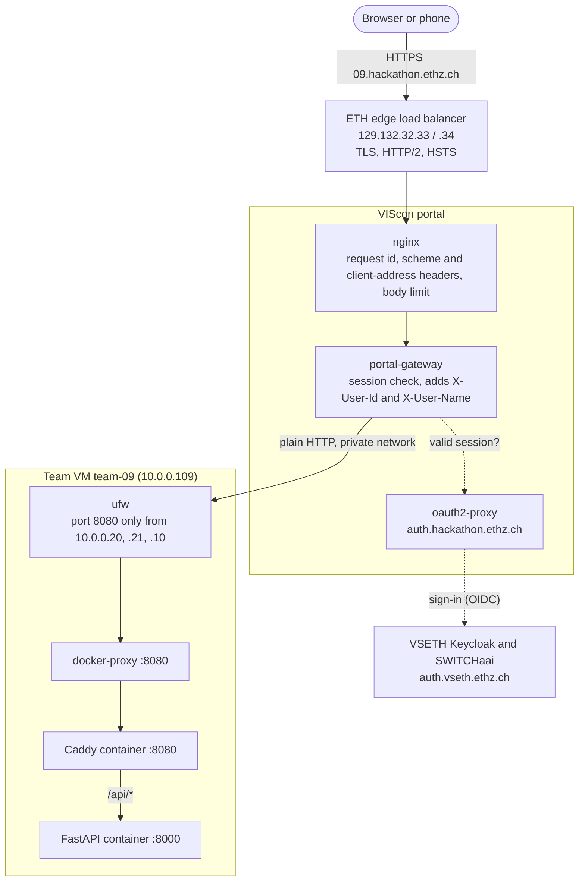

# MarkETH infrastructure reference (team 09)

What the VIScon hackathon gives us to build on: the team VM, the portal's reverse proxy and ETH sign-in in front of it, the firewall, the LLM proxy, and what each of them means for [`SPEC.md`](SPEC.md).

Measured on 9 Oct 2026 between 17:45 and 18:10 UTC, from inside the VM, with read-only requests. Nothing on the VM or the running app was changed. Every fact carries its basis:

| Basis | Meaning |
| --- | --- |
| **measured** | Observed directly on this VM or in a response from the infrastructure |
| **stated** | Said by the organizers in [`README.md`](README.md) or the SSH login banner (`/etc/motd`); not re-tested |
| **inferred** | Deduced from measured evidence; the reasoning is given |
| **open** | Not verified. [Section 13](#13-open-checks) says how to check it |

This file contains no secret values. It does contain addresses of our VM, so treat it as team-internal.

The links to `README.md`, `backend/app.py`, `backend/ai.py` and `frontend/src/api.ts` name files of the organizers' template, the app that ran on the VM when these measurements were taken. They lie in `~/template` on the VM and are not part of this repository. Where a section describes Caddy, it describes that template; MarkETH's own proxy is nginx (`infra/nginx/`).

## Contents

1. [What matters most](#1-what-matters-most)
2. [The path of a request](#2-the-path-of-a-request)
3. [ETH sign-in](#3-eth-sign-in)
4. [Request headers the app receives](#4-request-headers-the-app-receives)
5. [The VM](#5-the-vm)
6. [Firewall and network](#6-firewall-and-network)
7. [What runs on port 8080 today](#7-what-runs-on-port-8080-today)
8. [Edge behaviour and limits](#8-edge-behaviour-and-limits)
9. [Outbound connectivity](#9-outbound-connectivity)
10. [LLM proxy](#10-llm-proxy)
11. [Credentials and secrets](#11-credentials-and-secrets)
12. [What this means for SPEC.md](#12-what-this-means-for-specmd)
13. [Open checks](#13-open-checks)
14. [Working on the VM](#14-working-on-the-vm)
15. [Appendix: evidence and method](#15-appendix-evidence-and-method)

## 1. What matters most

1. **There is one way in.** `https://09.hackathon.ethz.ch` goes through the VIScon portal and arrives as plain HTTP on port 8080 of this VM. Apart from SSH, nothing else on the VM is reachable from outside.
2. **Users are already signed in when a request arrives.** The portal sends every visitor through ETH single sign-on and adds two headers to each request: `X-User-Id` (`<eth-username>@ethz.ch`) and `X-User-Name`. The magic-link login of SPEC §3 would ask users to sign in a second time.
3. **Those headers are plain text, not signed.** They can be trusted only because the firewall lets nobody but the portal reach port 8080. Anything running on the VM can forge them, which is handy for tests and fatal if the port is ever opened to the internet.
4. **The sign-in accepts every Swiss university, not only ETH.** The app must keep its own `ethz.ch` allowlist.
5. **The usual proxy headers lie.** At the backend, `X-Forwarded-For` is always the Docker gateway and `X-Forwarded-Proto` is always `http`. The visitor's address is in `X-Original-Forwarded-For`, the real scheme in `X-Forwarded-Scheme`.
6. **Server-sent events work end to end. WebSockets do not** (stated).
7. **Without a session the portal answers 302 to the login page, or 401 if the request says `Accept: application/json`.** Frontend `fetch` calls should send that header so an expired session is detectable.
8. **Every other team's app counts as the same site as ours** (`*.ethz.ch`). `SameSite` cookies do not protect against them; the Origin check of SPEC A.2 does.
9. **The VM is small and has no swap:** 4 vCPUs, 7.6 GiB RAM, 66 GB free disk, clock in UTC.
10. **Outbound HTTPS is open; outbound mail works only on port 587.**
11. **The LLM proxy offers one model and a 1 USD budget on the prefilled key.** The spec does not use it.

## 2. The path of a request



| # | Hop | What it does | Basis |
| --- | --- | --- | --- |
| 1 | DNS | `*.hackathon.ethz.ch` is a wildcard pointing at 129.132.32.33, 129.132.32.34, 2001:67c:10ec:4c48::133 and ::134, all ETH Zurich addresses | measured |
| 2 | ETH edge load balancer | Terminates TLS, speaks HTTP/2 to browsers, redirects port 80 to HTTPS, adds HSTS. A hostname with no team behind it (`99.hackathon.ethz.ch`) gets a "503 Service Unavailable, No server is available to handle this request" page | measured. That page and the port-80 redirect are HAProxy's stock responses, so the software is inferred |
| 3 | nginx inside the portal | Refuses oversized bodies with nginx's stock 413 page. Adds `X-Request-Id`, `X-Scheme`, `X-Forwarded-Scheme`, `X-Original-Forwarded-For`, which is the header set of the Kubernetes nginx ingress controller | inferred |
| 4 | Portal gateway (`portal-gateway-1`) | Maps `09` to our VM and port, checks the visitor's session with oauth2-proxy, adds `X-User-Id` and `X-User-Name`, forwards over the private network | header names measured, role stated, mechanics inferred |
| 5 | Private network | From 10.0.0.20 or 10.0.0.21 (backup 10.0.0.10) to 10.0.0.109:8080, plain HTTP/1.1 | source addresses stated, HTTP/1.1 measured |
| 6 | ufw on the VM | Lets the portal addresses and SSH in, drops everything else | stated, configuration partly measured ([section 6](#6-firewall-and-network)) |
| 7 | docker-proxy | The host process listening on 8080 that hands each connection to the Caddy container. Because of it Caddy sees every connection coming from 172.18.0.1 | measured |
| 8 | Caddy container (`frontend`) | `/api/*` goes to `backend:8000`; everything else is served from the built React files, with `index.html` as fallback | measured |
| 9 | FastAPI container (`backend`) | uvicorn on port 8000, reachable only inside the Docker network | measured |

Hops 3 and 4 sit somewhere between ETH and our VM. Their order and location are inferred and do not matter for building; the headers they produce do, and those are measured ([section 4](#4-request-headers-the-app-receives)).

Our identifiers all derive from the team number: URL `09.hackathon.ethz.ch`, VM hostname `team-09`, private address `10.0.0.109`.

## 3. ETH sign-in

### 3.1 What happens when someone signs in

1. The browser requests any URL on `09.hackathon.ethz.ch` without a session.
2. The portal answers `302` to VSETH's Keycloak at `https://auth.vseth.ethz.ch/auth/realms/VSETH/protocol/openid-connect/auth`. This is a standard OpenID Connect authorization-code flow: client `vis_vc2_prod_portal_oidc`, scopes `openid email profile`, callback `https://auth.hackathon.ethz.ch/oauth2/callback`. A 15-minute `_oauth2_proxy_csrf` cookie is set for `Domain=hackathon.ethz.ch` (HttpOnly, Secure). (measured)
3. Keycloak hands over to the SWITCHaai organisation picker at `wayf.switch.ch` ("You are signing in to the service VSETH SSO"). The user picks ETH Zurich and logs in with ETH credentials. (measured up to the picker)
4. The browser returns through Keycloak to oauth2-proxy at `auth.hackathon.ethz.ch`, which sets the session cookie and sends the browser back to the URL from step 1. (inferred: cookie name and lifetime not observed)
5. Every later request carries that cookie. The gateway validates it and adds the identity headers before forwarding to us.

The CSRF cookie is scoped to `hackathon.ethz.ch`, so the session cookie almost certainly is too. One sign-in then covers the portal and every team's app. (inferred)

We never talk to Keycloak or oauth2-proxy ourselves and need no OIDC client, secret or callback URL.

### 3.2 What a request without a session gets

All measured against `https://09.hackathon.ethz.ch`. None of these requests reached our VM.

| Request | Response |
| --- | --- |
| `GET /` or `GET /api/me` with `Accept: text/html` or `*/*` | `302` to Keycloak, HTML body |
| Any method (GET, HEAD, POST, PUT, PATCH, DELETE, OPTIONS) with `Accept: application/json` | `401`, `Content-Type: application/json`, body `{}` |
| `GET /api/todos/events` with `Accept: text/event-stream` (what `EventSource` sends) | `302` to Keycloak |
| `X-Requested-With: XMLHttpRequest` without a JSON `Accept` | `302` to Keycloak |
| CORS preflight `OPTIONS` from another origin | `302` (or `401` with a JSON `Accept`) |
| A made-up `X-User-Id` header, or `Authorization: Bearer <garbage>` | `401`. Neither bypasses the session check |

Consequences for the frontend:

- **Send `Accept: application/json` on every API call.** The template's `request()` in [`frontend/src/api.ts`](frontend/src/api.ts) does not, so an expired session makes `fetch` follow a redirect to another origin and fail with an opaque network error.
- **Treat a `401` whose body is `{}` as "portal session gone"** and reload the page; the reload triggers the sign-in and returns to the same URL. Our own API errors have the `{code, message, details}` shape of SPEC A.2, so the two cannot be confused.
- **`EventSource` cannot see a 401.** It gets the redirect and keeps retrying. When a stream errors, probe a JSON endpoint and reload on 401.
- **Cross-origin API use is impossible while access control is on**, because preflights cannot carry a session. The single-origin layout of SPEC §9 is the only one that works.
- **Scripts cannot get in from outside.** curl, load-test tools, uptime monitors and webhooks from the internet all end at the login redirect. Run them on the VM ([section 14](#14-working-on-the-vm)).

### 3.3 The identity headers

| Header | Value | Notes | Basis |
| --- | --- | --- | --- |
| `X-User-Id` | `<eth-username>@ethz.ch` | README: "the user's email address, which uniquely identifies them". The one real value seen was six lowercase letters before `@ethz.ch`: an ETH username, not a `first.last@student.ethz.ch` address | measured (one sample), stated |
| `X-User-Name` | `First Last` | Non-ASCII characters are percent-encoded (`Zo%C3%AB` for "Zoë"). Decode with `urllib.parse.unquote` | stated, decoding measured locally |

Both headers are absent when the portal's access control is set to "Disabled" (stated) and on any request that did not come through the portal, such as curl on the VM (measured). The template then falls back to one shared "Guest" user. For MarkETH that fallback would mean a shared wallet, so it must not exist outside local development.

Each of us can see our own id by opening `https://09.hackathon.ethz.ch/api/me` while the template is still deployed.

### 3.4 Why the headers can be trusted, and when they cannot

The headers are ordinary request headers. There is no signature or token to verify. The backend echoes whatever it is given (measured on the VM):

```console
$ curl -s localhost:8080/api/me -H 'X-User-Id: infra-test@example.org' -H 'X-User-Name: Zo%C3%AB%20Test'
{"id":"infra-test@example.org","name":"Zoë Test"}
```

They are trustworthy only because of the network path:

- ufw lets only the portal's addresses reach port 8080 (stated; [section 6](#6-firewall-and-network)).
- An unauthenticated request with a forged `X-User-Id` is stopped at the portal with 401 (measured).
- Whether the portal overwrites an `X-User-Id` supplied by the browser is not separately verified; the 401 above shows the gateway owns these headers for unauthenticated traffic (open check 13.3).

The practical rule: **treat `X-User-Id` and `X-User-Name` as trusted input as long as port 8080 is reachable through the portal only** (the default). Keep the port closed to the internet, keep the Origin check of SPEC A.2, and keep the app's own `ethz.ch` allowlist. None of those depend on the header being signed.

## 4. Request headers the app receives

The portal adds headers, then our Caddy adds and rewrites a few more before the backend sees them. Measured two ways: by decoding the one real forwarded request in Caddy's log (identities masked), and by running a throwaway copy of the same Caddy image in front of an echo server on loopback and sending it synthetic requests.

What the FastAPI backend sees on a normal request:

| Header | Example value | Set by | Use it for |
| --- | --- | --- | --- |
| `X-User-Id` | `<username>@ethz.ch` | portal | the user's identity: one id is one account |
| `X-User-Name` | `First Last`, non-ASCII percent-encoded | portal | display name; `unquote` it |
| `X-Original-Forwarded-For` | the client address the portal recorded | portal | the visitor's address, for logging/limits |
| `X-Real-Ip` | a portal-internal address | portal | not the visitor; ignore |
| `X-Forwarded-Scheme`, `X-Scheme` | `https` | portal | **the real scheme** |
| `X-Forwarded-Host` | `09.hackathon.ethz.ch` | portal (kept by Caddy) | the public host |
| `X-Request-Id` | 32 hex chars | portal | correlate a request across logs |
| `X-Forwarded-Server` | `portal-gateway-1` | portal | identifies the portal hop |
| `Cookie` | written as `REDACTED` in Caddy's log, so which cookies arrive is open check 8 | browser | not ours; do not parse |
| `X-Forwarded-For` | `172.18.0.1` | **Caddy overwrites** | the Docker gateway, **not** the visitor |
| `X-Forwarded-Proto` | `http` | **Caddy overwrites** | the Caddy→backend hop, **not** the real scheme |
| `Via` | `1.1 Caddy` | Caddy | marks the proxy hop |

Three things to get right because they are easy to get wrong:

- **The visitor's scheme is `https`, but `X-Forwarded-Proto` says `http`.** Default Caddy rewrites `X-Forwarded-Proto` to the scheme of its own (plaintext) hop. Read `X-Forwarded-Scheme` or `X-Scheme` for the real one. If the app ever builds absolute URLs or sets Secure cookies from the request scheme, use those headers (or just hard-code `https`), or it will downgrade to `http`.
- **The visitor's address is not in `X-Forwarded-For`.** Caddy overwrites it with the immediate peer (the Docker gateway `172.18.0.1`), because it has no `trusted_proxies` set. The address the portal saw is in `X-Original-Forwarded-For`. For per-user rate limits, key on `X-User-Id`, not on any forwarded address.
- **Underscore header names are dropped by Caddy.** A header like `X_User_Id` reaches a bare backend but is removed when it passes through Caddy (measured). Only the real `X-User-Id` arrives, which is one fewer thing to worry about.

MarkETH's nginx (`infra/nginx/conf.d/default.conf.template`) is built on these three facts. It takes the visitor's address from `X-Original-Forwarded-For` and the scheme from `X-Forwarded-Scheme`, believes both only when the connection comes from the portal's side, and hands them to the API as the client address and as `X-Forwarded-Proto`. Its rate limit is keyed on `X-User-Id`, with the client address as the key of a request that names nobody. It hands `X-User-Id` and `X-User-Name` to the API as they arrived and to the web app not at all, and it removes the `Cookie` header on the way to both. Like Caddy, nginx ignores a header whose name has an underscore.

## 5. The VM

| Property | Value | Basis |
| --- | --- | --- |
| Host | `team-09`, Hetzner vServer (KVM) | measured |
| OS | Ubuntu 26.04.1 LTS, kernel 7.0.0-30-generic, x86-64 | measured |
| CPU | 4 vCPU AMD EPYC-Rome; AES and AVX2 yes, AVX-512 no | measured |
| RAM | 7.6 GiB, **no swap**, ~6 GiB available at rest | measured |
| Disk | 76 GB root, ~66 GB free, 3% inodes used | measured |
| Clock | UTC, NTP-synced via chrony; `TZ` unset (so UTC) | measured |
| Public NIC | `eth0` 188.245.14.160, IPv6 `2a01:4f8:c016:e9ec::/64`; default route | measured |
| Private NIC | `enp7s0` 10.0.0.109/32; route to 10.0.0.0/24 (the portal network) | measured |
| Login | user `viscon`, groups `sudo` and `docker` | measured |
| sudo | works, but **asks for a password** (not passwordless) | measured |

Pre-installed and useful: `docker` 29.9.0 + `compose` v5.6.0 + `buildx`, `python` 3.14 (uv-managed) and system 3.14.4, `node` 24.21.0 + `npm` 11.19, `git`, `curl`, `wget`, `dig`, `openssl`, `jq`, `make`, `gcc`, `tcpdump`, `nc`, `tmux`, `htop`, `vim`, `rsync`, `strace`, `lsof`, `ufw`, `nft`.

Not installed (install or containerise if needed): `gh`, `psql`, `redis-cli`, `cqlsh`, `sqlite3`, `go`, `cargo`, `java`, host `nginx`/`caddy`, `socat`, `nmap`, `pnpm`/`yarn`/`bun`.

Being in the `docker` group is effectively root on the host (a container can mount `/`). Treat it accordingly; it also means Docker commands need no `sudo`.

## 6. Firewall and network

The organizers state the firewall design in the SSH login banner (`/etc/motd`), quoted because it is authoritative:

> UFW only lets in SSH and traffic from our portal:
> Portal: 10.0.0.20, 10.0.0.21 — Portal (backup): 10.0.0.10.
> There is no other firewall between this VM and the internet.
> To expose a port directly to the internet, e.g. TCP 8080: `sudo ufw allow 8080/tcp`.
> This also covers Docker containers (use the published port). Unlike stock Docker, published ports stay closed until you allow them. From the VM itself (localhost), every port works without a rule.
> Don't modify or remove anything marked "VIScon Admin".

What this means in practice:

- **The portal is the only way in to the app, and that needs no ufw change** — the portal's private addresses are already allowed. Keep the port reachable through the portal and let the portal do access control and SSO.
- **A port is not public just because Docker published it.** Normally `docker compose` publishing a port punches through a host firewall; here a VIScon-admin rule (the `viscon-admin-skip-docker-dnat` NAT hook in `/etc/ufw/before.init`, measured) routes published ports through ufw first, so they stay closed until `sudo ufw allow`. Do not touch that hook.
- **From the VM itself every port is open** (`localhost:8000`, `localhost:8080`, a database you add) — which is why all testing in this document ran on the VM.
- **MarkETH relies on exactly this rule.** Its port is published on every interface of the VM, the public one included, and ufw is what keeps it closed there: an accepted risk, recorded as check 7 of [section 13](#13-open-checks).

Measured and consistent with the above: ufw is enabled, default policy input DROP / output ACCEPT / forward DROP; the only externally-listening sockets are TCP 22 (SSH) and TCP 8080. The detailed `user.rules` need root to read, so the exact allow list is stated, not measured.

SSH currently allows password login (`PasswordAuthentication yes`, with a drop-in that invites adding your own key and turning it off). There is no `authorized_keys` yet. SSH access seen from 195.176.112.74 (an ETH network).

## 7. What runs on port 8080 today

The deployed `template` compose project, two services on the `template_default` network (172.18.0.0/16):

**`frontend` — Caddy 2.11.7**, the reverse proxy and static server. Publishes `8080`. Its effective routing (read from Caddy's admin API, measured):

- `/api/*` → `reverse_proxy backend:8000`
- everything else → serve from `/srv` (the built React app), with `try_files {path} /index.html` so client-side routes work on reload; the `Caddyfile` itself is hidden.
- No compression, no added security headers, no app-level rate limit, no TLS (the edge terminates it). The admin API listens only on `127.0.0.1:2019` inside the container.

**`backend` — uvicorn / FastAPI** on `8000`, reachable only inside the Docker network (no published port). In-memory todo state, so **all data is lost on restart or rebuild** (there is no volume and no database). Carries the three `LLM_*` env vars. Image is `python:3.14-slim` with `fastapi` 0.142.4, `starlette` 1.7.0, `uvicorn[standard]` 0.54.0 (brings `uvloop`, `httptools`, `websockets`), `pydantic` 2.13.5, `openai` 3.26.1, `httpx`, `anyio`.

Observations that matter later:

- `GET /api/docs` and `/api/openapi.json` are served (FastAPI's docs) and reachable through the portal.
- `GET /api` (no trailing slash) is **not** matched by `handle /api/*` and falls through to the SPA — keep API paths under `/api/`.
- When the backend is down, Caddy answers `/api/*` with `502` and still serves the static site (measured in the lab).
- `python:3.14-slim` resolves `Europe/Zurich` via the system zoneinfo, but the `tzdata` PyPI package is not installed. If a future base image drops `/usr/share/zoneinfo`, add `tzdata` to `requirements.txt` or set `TZ`. The container's own clock is UTC.
- Container logs use `json-file` with **no size limit** — fine for a template, but over a multi-day event long-running containers can fill disk. MarkETH's `compose.yaml` limits every container's log (`CONTAINER_LOG_MAX_SIZE`, `CONTAINER_LOG_MAX_FILES`).

## 8. Edge behaviour and limits

All measured from the VM against the public URL; these describe the ETH edge and portal, which we do not control, so build to them rather than around them.

| Property | Value |
| --- | --- |
| TLS | 1.2 and 1.3 only; 1.0/1.1 refused. ALPN `h2`. Cert `*.hackathon.ethz.ch` + `hackathon.ethz.ch`, Let's Encrypt ECDSA P-256, valid 20 Sep–19 Dec 2026 |
| HTTP | HTTP/2 to the browser; HTTP/3 advertised via `alt-svc h3=":443"`; port 80 → 302 to HTTPS |
| HSTS | `max-age=16000000; includeSubDomains; preload` on every response |
| Request body | ≥12 MiB still reaches the auth layer; ~32 MiB returns the edge's `413` before auth. Exact cap not pinned (between those). MarkETH enforces its own small limit in nginx |
| URL length | a ~4 KiB query string is fine; ~12 KiB returns `502`. Keep URLs short |
| Header size | a single ~6 KiB header already breaks the HTTP/2 framing. Keep headers small |
| Round trip | ~45–60 ms for a full VM→public-edge→VM round trip (the external path; portal→VM over the private net is much less) |
| Server-sent events | work end to end: `X-Accel-Buffering: no`, chunked, first bytes immediately, keep-alive `: ping` every 15 s (measured through Caddy on the VM) |

The generous edge body limit means the `client_max_body_size 64k` of SPEC §9 is enforced by **us**: nginx refuses a larger body with `NGINX_CLIENT_MAX_BODY_SIZE` from `.env`, and `make deploy-check` sends one body above the limit and one below it. The edge does not do it at that size.

## 9. Outbound connectivity

| Destination | Result |
| --- | --- |
| HTTPS to pypi, npm, Docker Hub, ghcr.io, GitHub, api.openai.com, openrouter.ai, Debian, the LLM proxy | open, IPv4 and IPv6 |
| SSH to github.com:22 | open |
| SMTP submission on **587** (gmail, mail.ethz.ch, SendGrid, Mailgun) and SendGrid **2525** | open |
| SMTP on **25** and implicit-TLS **465** | blocked |
| Docker Hub anonymous pulls | 100 per hour per IP (from the rate-limit header) |

Implications: package installs, image pulls and git all work. If the build hits Docker Hub's 100/hour limit, log in with a Docker account or pull from a mirror. If we ever send mail, it must be STARTTLS on 587 (not 465 or 25) — but the portal already handles sign-in, so the spec's magic-link mail is not needed (see below).

## 10. LLM proxy

`https://llm.hackathon.ethz.ch` is a **LiteLLM 1.104.0** gateway, OpenAI-compatible, in front of OpenRouter.

- **No key needed:** `/` (Swagger UI), `/health/liveliness`, `/health/readiness` (`{"status":"healthy","db":"connected"}`), `/openapi.json`, `/routes`.
- **Key needed:** `/v1/models`, `/v1/chat/completions`, and the rest of the OpenAI surface. The prefilled key is a restricted LiteLLM *virtual key* — it may call the LLM routes only; admin routes (`/key/info`, `/user/info`) return 403.
- **One model:** `openrouter/deepseek/deepseek-v4.1-flash`. Context 1,048,576 in / 943,718 out. Advertises tools/function-calling, JSON-schema response format (what `ai.py` uses), vision, reasoning and prompt caching.
- **Budget:** the shared key has a `max_budget` of 1.00 USD (returned in the `x-litellm-key-max-budget` header, with running `x-litellm-key-spend`). README: the shared key is demo-only with limited quota — set the team's own `LLM_API_KEY` in `.env` for real work. Pricing seen: ~$0.044 / M input tokens, $0.30 / M output, $0.015 / M cache-read.
- **Gotcha:** it is a reasoning model. A tiny-`max_tokens` request spent its whole budget on hidden reasoning tokens and returned `finish_reason: "length"` with empty content. Give completions a generous `max_tokens`, and read `usage` to track spend.

MarkETH does not need the LLM for its core flow. It could help with the SPEC §6 content rules (screening proposed market questions) or drafting market wording — optional, and easy to add via the existing `openai` client pattern in [`backend/ai.py`](backend/ai.py).

## 11. Credentials and secrets

- `.env` (git-ignored, present) holds `LLM_API_BASE`, `LLM_API_KEY` (the shared demo key) and `LLM_MODEL`; the backend container gets them as environment variables. Keep real keys in `.env`, never commit them, and remember admins can read the VM (motd).
- `git` remote is the upstream template (`AndriMcFly/viscon-hackathon-template`) over HTTPS; the committer is `team-09@hackathon.ethz.ch`. No push credentials are stored, so a push will prompt — set our own remote/credentials for team code.
- `~/.claude/.credentials.json` and a session key under `~/.claude/` belong to this Claude Code session, not the project.
- There is **no** database, cache, or message store running — the spec's Postgres, Redis and ScyllaDB are ours to add.

## 12. What this means for SPEC.md

The spec was written for a self-hosted stack with its own login. The portal changes several sections. This is the mapping.

**Authentication (SPEC §3) — replace with the portal.** Do not build magic links, `login_tokens`, the mail flow, or auth sessions. Identity arrives as `X-User-Id` on every request. Everyone who reaches us is already ETH-signed-in, so there is no "verify email" step; the signup grant (SPEC §2) books the first time a new `X-User-Id` is seen. Keep `extract_user()` as the single choke point ([`backend/app.py`](backend/app.py)).

**Keep the allowlist, and take an id as it comes (SPEC §2, §3).** Sign-in goes through SWITCHaai, which offers every Swiss university, not only ETH, so the app checks every `X-User-Id` against `ALLOWED_EMAIL_DOMAINS`, which holds `ethz.ch` alone. For ETH users the id is `<username>@ethz.ch` (lowercase, no `+` tag, no dot in the one sample). The API accepts an id only if, in lower case, it is exactly `[a-z0-9][a-z0-9._-]{0,63}@ethz.ch`, and it rewrites nothing: one id is one account. What the id of a non-ETH account looks like is open check 2; whatever it is, it is refused.

**Roles (SPEC §3, A.3).** Set `ADMIN_EMAILS` / `BARISTA_EMAILS` in `.env`, keyed on `X-User-Id`, and derive the role per request. No bootstrap table needed.

**Sessions (SPEC §3, §7).** The portal owns the browser session, so the app needs no session table for auth. A `users` row per `X-User-Id` is still needed for balances and the lazy monthly-grant / ticket upkeep of SPEC A.3 — trigger that upkeep on each authenticated request instead of on a session cache-miss.

**Origin check (SPEC A.2) stays.** Every team's app is under `*.ethz.ch` and shares the signed-in session, so `SameSite` does not isolate us from them. Keep the Origin check on state-changing requests with `ALLOWED_ORIGINS=https://09.hackathon.ethz.ch`. The portal forwards the `Origin` header. In front of that check, nginx refuses every `/api/` request a browser marks as made by another site (`Sec-Fetch-Site: same-site` or `cross-site`), reads included, before the request counts against a limit: another team's page cannot use up the rate limit or the event streams of whoever looks at it. A window that opens an API address from elsewhere is let through, which is how the sign-in returns. Whether the portal passes `Sec-Fetch-Site` on is check P13.

**Scheme and cookies.** The app sees `X-Forwarded-Proto: http`; the real scheme is `https` (section 4). If we set any cookie, force `Secure` and do not derive it from the request scheme. We likely need no cookies of our own.

**Live updates (SPEC §8, §9).** Server-sent events work through the whole path, so the Redis-pub/sub → SSE quote stream is viable. **WebSockets do not work through the portal** (stated in README; use SSE or Socket.IO's HTTP long-polling). Keep a single backend process, or move the pub/sub to Redis so replicas share streams.

**Infrastructure services (SPEC §9).** `compose.yaml` runs Postgres, Redis and ScyllaDB as services with **no published ports**, beside `api`, `relay`, the `migrate` one-shot and `web`. The stack has two networks: `core` holds the API, the relay, `migrate` and the three stores, `edge` holds the web app, and nginx alone is on both. The web app therefore cannot open a connection to the API or to a store (Redis and ScyllaDB ask for no password); the proxy is all it reaches. Of the three backend services only `migrate` is handed the password of the Postgres owner role. **The proxy is nginx**, as the spec describes, and it is the only container with a published port: 8080, the one the portal forwards to. `infra/nginx/conf.d/default.conf.template` holds what the measurements above ask of a proxy here: compression, the 64k body limit, the security headers with the Content-Security-Policy, an unbuffered location for event streams, the outer rate limit per signed-in user, the visitor's address and scheme taken from the portal's headers, the identity headers handed to the API alone, the refusal of what another site makes a browser ask of the API, and an access log without query strings, referers and cookies. The stack has **no mail service**: the portal signs people in.

**Enforce the spec's own limits.** The edge does not apply the spec's 64k body cap or per-user rate limits at the sizes we care about, so nginx and the API do (SPEC §5, §9, A.2).

**Fit it in 7.6 GiB with no swap.** Postgres + Redis + ScyllaDB + api + relay + web + nginx coexist. ScyllaDB runs with the spec's flags verbatim (`--smp 1 --memory 750M --overprovisioned 1 --developer-mode 1`, SPEC §9), and every container has a hard memory limit from `.env` (the `*_MEMORY_LIMIT` variables); `make deploy-status` shows what each one uses. This is the tightest physical constraint on the VM.

**Timezone.** Container clock is UTC; the spec does grants and proposal limits in `Europe/Zurich` (SPEC §2, A.3). `zoneinfo` resolves `Europe/Zurich` in the current image; set `APP_TIMEZONE=Europe/Zurich` and, to be safe across base-image changes, add `tzdata` to `requirements.txt`.

**Deploy.** `make deploy` from a laptop ([section 14](#14-working-on-the-vm)). **8080** stays the published port (the portal forwards to it); if `NGINX_HTTP_PORT` changes, it changes in the portal's network config too. No ufw change is required to keep serving through the portal.

## 13. Open checks

Things I could not verify from the VM; each matters for a spec decision.

1. **Exact edge body-size limit** — somewhere between ~12 MiB and ~32 MiB. Narrowing it was blocked mid-run; re-run a size sweep on the VM if the precise cap matters (it should not, since we enforce 64k ourselves).
2. **Non-ETH `X-User-Id` shape** — only an ETH id (`<username>@ethz.ch`) was observed. If non-ETH SWITCHaai users can sign in, confirm what their id looks like and that the allowlist refuses it. Check by having a non-ETH teammate sign in, or ask the organizers whether the portal restricts to ETH.
3. **Does the portal overwrite a browser-supplied `X-User-Id`?** Unauthenticated forgery is rejected (measured); a signed-in user sending their own header was not tested. The defensive posture (port closed to the internet, Origin check, own allowlist) does not depend on the answer, but confirm with the organizers before trusting the header for anything irreversible.
4. **Session cookie name, lifetime and idle timeout** — not observed; only the 15-minute CSRF cookie was seen. Matters only if we want to react to session expiry beyond reloading on a JSON 401.
5. **Portal access-control settings** — configured in the portal UI, not on the VM. Confirm it is **enabled** (so identity headers are present); with it disabled, everyone is the shared "Guest", which for MarkETH would mean one shared wallet.
6. **Published-port-closed-until-allowed** behaviour — stated by the organizers; trust it, or verify with a scratch service and an external check before relying on a port being private.
7. **The app listens on every interface of the VM (accepted risk).** `infra/deploy/env.production` sets `NGINX_HTTP_BIND=0.0.0.0`, so nginx is published on the public interface as well as on the private one the portal uses, as the template is. Publishing on `10.0.0.109` alone was weighed and set aside: that address can come up after Docker has started, Docker does not try again to bind a port it could not bind, and the stack would come back from a reboot without its proxy until someone looked (measured in the review of the deployment: the VM's wait for the network is satisfied by one routable link, `net.ipv4.ip_nonlocal_bind` is 0, and a reboot is pending). What is accepted with that: on the public interface ufw alone stands between the internet and a port on which whoever connects is believed to be whoever they say ([section 3.4](#34-why-the-headers-can-be-trusted-and-when-they-cannot)), and the rule that keeps a published port closed is the organizers', stated and not ours to keep (check 6). The standing check is the outside probe. `make deploy-check` ends on the laptop by asking `http://<public address of the VM>:8080/api/health` and fails unless the connection is refused or times out; an answer stops the deployment with the instruction to close the port. It runs at every deploy, and belongs after every reboot of the VM and every change to ufw or Docker there. The probe asks the public IPv4 address. `0.0.0.0` is IPv4 only, so the stack has no listener on the VM's IPv6 address (inferred from how Docker publishes a port), and the part of `make deploy-check` that runs on the VM fails if the port is bound to any address but the one `.env` names. Measured once, with the template publishing `0.0.0.0:8080`: `curl -m 8 http://188.245.14.160:8080/api/me` from a laptop timed out.
8. **Does the portal hand its session cookie on to team VMs?** A browser sends the portal's session cookie with every request for a team's app, which is how the gateway knows the visitor ([section 3.1](#31-what-happens-when-someone-signs-in)); whether the gateway takes the cookie out before it forwards the request is not known. The template's proxy log cannot answer it: Caddy writes the value of a `Cookie` header as `REDACTED`, so the one real request seen there shows that a `Cookie` header arrived, not which cookies it held. What it would mean if the cookie is forwarded: every team's server receives a working portal session of each person who opens that team's app while signed in. With it the server can send requests of its own to `https://09.hackathon.ethz.ch`, and the portal names that person on each of them: trades, vouchers and, for an admin, resolutions, in their name. Such a request comes from a server, not from a browser, so it carries whatever `Origin` and `Sec-Fetch-Site` its sender likes, and neither the Origin check nor nginx can tell it from the person. Nothing in this repository can prevent that; only the organizers can, by removing the cookie at the gateway. MarkETH keeps nothing of what arrives here: nginx removes the `Cookie` header before the API and the web app and writes no cookie into its log. The first deployment answers the question. nginx's access log has a field `portal_cookie`, which is `true` for a request that carried a cookie whose name starts with `_oauth2_proxy` (the prefix of oauth2-proxy's cookies here, as the name of its CSRF cookie shows) and `false` for every other request. Check P12 reads it.

### 13.1 Checks made through the portal

From the VM and from outside, a request without a portal session ends at the portal ([section 3.2](#32-what-a-request-without-a-session-gets)). `make deploy-check` and `make deploy-smoke` therefore prove the stack from the VM with forged headers, and what is listed here can only be seen by a person who is signed in at `https://09.hackathon.ethz.ch`. Each time one of them is checked, a line goes into the record below: the date, who looked, and what they saw. A check that is repeated gets a second line; lines are never rewritten.

| # | Check | How |
| --- | --- | --- |
| P1 | A browser cannot name itself (open check 3) | Signed in, in the browser console: `fetch('/api/me', {headers: {'X-User-Id': 'someone-else@ethz.ch', 'Accept': 'application/json'}}).then(r => r.json()).then(console.log)`. The answer must never be the forged id. Made while the template runs, because it echoes the id it was given; a forged id that comes back stops the deployment and goes to the organizers |
| P2 | Portal access control is enabled (open check 5) | The setting in the portal UI; `/api/me` answers with one's own id |
| P3 | Sign-in arrives | Opening the address leads through ETH sign-in to the profile set-up, which greets by the right name, umlauts included |
| P4 | A write passes the Origin check | Saving the profile works and the welcome tokens are there. A 403 here means the portal does not forward `Origin` unchanged |
| P5 | The admin is the admin | Each id in `ADMIN_EMAILS` sees the Admin tab: the ids are spelled as the portal sends them |
| P6 | An event stream stays open and is unbuffered | Two phones on one market: a trade on one moves the price on the other within a second |
| P7 | The Content-Security-Policy fits the app | No violation in the browser console on any screen; the camera prompt appears on the barista scanner |
| P8 | Whether the portal shows team apps inside a frame | If it does, the app is blank there (`frame-ancestors 'none'`), and that one origin is added to the policy, never a wildcard |
| P9 | The visitor's address arrives | After visits by several people, `make deploy-logs`: nginx's access log shows a different client address per person and their ids |
| P10 | An account from outside ETH is refused (open check 2) | A SWITCHaai account of another university gets 403 from the API |
| P11 | The product, on a phone | A trade, a resolution by an admin, a voucher scanned on the barista screen, the leaderboard |
| P12 | Whether the portal's session cookie reaches the VM (open check 8) | After the first signed-in visits, `make deploy-logs`: the field `portal_cookie` in the lines of nginx's access log that name a `user`. `false` in all of them: the gateway takes the cookie out. `true`: it is forwarded, and the organizers are told what that allows between teams |
| P13 | The proxy learns where a request comes from | Signed in, on a page of another host under `hackathon.ethz.ch` (the portal, another team's app), in the browser console: `fetch('https://09.hackathon.ethz.ch/api/config', {mode: 'no-cors', credentials: 'include'})`. `make deploy-logs` then shows that request with status 403. A 200 means the portal does not pass `Sec-Fetch-Site` on, and another team's page can use up a visitor's rate limit |

Record:

| Date (UTC) | Check | By | Result |
| --- | --- | --- | --- |
| | | | |

## 14. Working on the VM

MarkETH is deployed from a laptop with `make`; nothing is edited on the VM. `DEPLOY_SSH_HOST` and `DEPLOY_PATH` in the laptop's `.env` name the VM (an SSH alias) and the directory under its home directory. Every `deploy-*` target prints what it is about to do there before it does it. `make deploy` refuses a `DEPLOY_PATH` that is not a plain directory name, or that is `template`: the sync deletes whatever else that directory holds.

What lies on the VM:

| Path | What it is |
| --- | --- |
| `~/marketh` | A mirror of this repository's tree, without `.git`, `compose.override.yaml` and `infra/nginx/dev/`. The images are built from it, on the VM (the laptop has another CPU architecture) |
| `~/marketh/.env` | Rendered on the VM at every deploy from `.example.env`, `infra/deploy/env.production` and the file below. Never copied from a laptop |
| `~/marketh.env` | What only the VM knows: the two Postgres passwords, generated there at the first deploy, and the admin and barista ids. Readable by `viscon` only (and by the organizers, who have root) |
| `~/marketh-backups/` | One `pg_dump` file per deploy and per wipe |
| `~/template` | The organizers' template. `make deploy` stops its containers and leaves its files and images alone |

- **Deploy for the first time:** `make deploy ADMIN_EMAILS=<id>[,<id>] [BARISTA_EMAILS=<id>[,<id>]]`. The ids are the `X-User-Id` values of those people ([section 3.3](#33-the-identity-headers)). With a single admin the command warns: an admin who traded a market may not settle it. Check P1 of [section 13.1](#131-checks-made-through-the-portal) comes first, while the template still runs.
- **Redeploy:** `make deploy`. It runs these targets in this order and stops at the first that fails:

  | Target | What it does on the VM |
  | --- | --- |
  | `deploy-backup` | Dumps the database into `~/marketh-backups/`, if a database volume exists |
  | `deploy-sync` | `rsync --delete` of the tree into `~/marketh`; the VM's `.env` is excluded and stays |
  | `deploy-env` | Renders `~/marketh/.env` and lets Compose validate it. `ADMIN_EMAILS=` or `BARISTA_EMAILS=` on the command line replaces that role list; left out, the lists stay |
  | `deploy-build` | Tags the images in use as `previous`, then builds the images of this tree. The running stack is not touched |
  | `deploy-pull` | Pulls the nginx, Postgres, Redis and ScyllaDB images |
  | `deploy-migrate` | Runs the `migrate` image just built, once: it builds the schema in an empty database and refuses a database built from other models. A failure ends the deployment here, with whatever served before still serving |
  | `deploy-stop-template` | `docker compose down` in `~/template`, which frees port 8080 |
  | `deploy-up` | `docker compose -f compose.yaml up --detach --wait`, then recreates nginx so that it reads the proxy files of this tree. For about a second the port refuses connections |
  | `deploy-check` | `infra/deploy/check.sh` on the VM: health; a request without identity headers is refused; a request that names a caller is believed; two `X-User-Id` lines are refused; a request another site makes to the API is refused and a window that navigates there is not; the 64k limit; the rate limit; no development identity in the tree or in the running nginx; nginx is the only published port, bound to `0.0.0.0:8080` and nothing else. Then, from the laptop: the VM's public address does not answer on 8080 |

- **A schema change means a wipe.** The schema has one revision and no upgrade path. Once people hold balances, a deploy whose models differ stops at `deploy-migrate`, and the only way forward deletes those balances. Every model-affecting change therefore lands before the first real user.
- **Wipe:** `make deploy-wipe CONFIRM=wipe` dumps the database, stops the stack and deletes its volumes. `make deploy` then starts it empty, with the passwords `~/marketh.env` already holds. To get a dump back into an empty database: `cd ~/marketh && docker compose -f compose.yaml exec -T postgres sh -c 'exec pg_restore --username "$POSTGRES_USER" --dbname "$POSTGRES_DB"' < ~/marketh-backups/<file>`.
- **Keep `~/marketh.env`.** Postgres takes its passwords when its volume is created. With the volume in place and the file gone, `deploy-env` refuses to invent passwords; the ways out are putting the file back or a wipe.
- **Walk the product:** `make deploy-smoke CONFIRM=smoke` runs `infra/deploy/smoke.sh` on the VM: profile set-up for two made-up people and the first admin, a market proposed and approved, a trade, an event stream, a resolution, a voucher issued and redeemed, the leaderboard, and the ledger summing to zero. It writes all of that into the database, so it is for an empty one and is followed by a wipe.
- **Logs and state:** `make deploy-logs` follows every service; `make deploy-status` shows the containers with their memory use, free memory and disk. Each container keeps a bounded amount of log.
- **Roll back to the template:** `make deploy-rollback` stops the MarkETH containers (the volumes stay) and starts the template again. `make deploy` switches back.
- **Go back one release of MarkETH:** on the VM, `cd ~/marketh`, then `for name in api relay migrate web; do docker tag marketh-$name:previous marketh-$name:latest; done`, then `docker compose -f compose.yaml up --detach --no-build --force-recreate`. It works as long as both releases have the same models; the next `make deploy` builds from the tree again.
- **Act as a specific person from the VM** (localhost needs no portal and no ufw rule):
  `curl -s localhost:8080/api/me -H 'X-User-Id: you@ethz.ch' -H 'X-User-Name: Your%20Name'`. A request that changes something also needs `-H 'Origin: https://09.hackathon.ethz.ch'`. Without `X-User-Id` the API answers 401: nothing on the VM invents a caller.
- **See the app from your laptop:** you cannot hit `09.hackathon.ethz.ch` without going through SSO. `ssh -L 8080:localhost:8080 viscon-2026` brings the VM's port to `http://localhost:8080`, but a browser there sends no identity headers, so the app loads and every API call is 401. For a signed-in view use the portal, or the development stack on the laptop (`make up`, identities at `/__dev/identity`).
- **Housekeeping:** 66 GB were free at the time of measurement; the build cache grows with every deploy (`docker builder prune`, `docker image prune`). Never `docker system prune --all` or `docker volume prune --all` while a stack is stopped: the first deletes the images of the stopped one, the second its databases. `sudo` needs a password; Docker commands do not.
- **Run load tests, probes and monitors on the VM**, not from outside — external traffic ends at the sign-in redirect.

## 15. Appendix: evidence and method

Gathered 9 Oct 2026, 17:45–18:10 UTC, from inside the VM, with read-only requests. The app and VM were not modified; the two lab containers used to observe Caddy's behaviour ran on loopback / a scratch network and were removed afterwards.

Privacy: only this team's own VM and the shared infrastructure were examined — no other team's app was probed. The single real user request found in Caddy's log was decoded only to learn the header **names and shapes**; the id, name and cookie values were masked in place and are not recorded here or anywhere. This file contains no secret values, but it does name our VM's addresses, so keep it team-internal.

"Stated" facts (the firewall allow-list, WebSocket blocking, published-port behaviour, admin root access) come from [`README.md`](README.md) and the SSH login banner and were not independently tested. Everything marked "measured" was observed directly; "inferred" conclusions show their reasoning inline.