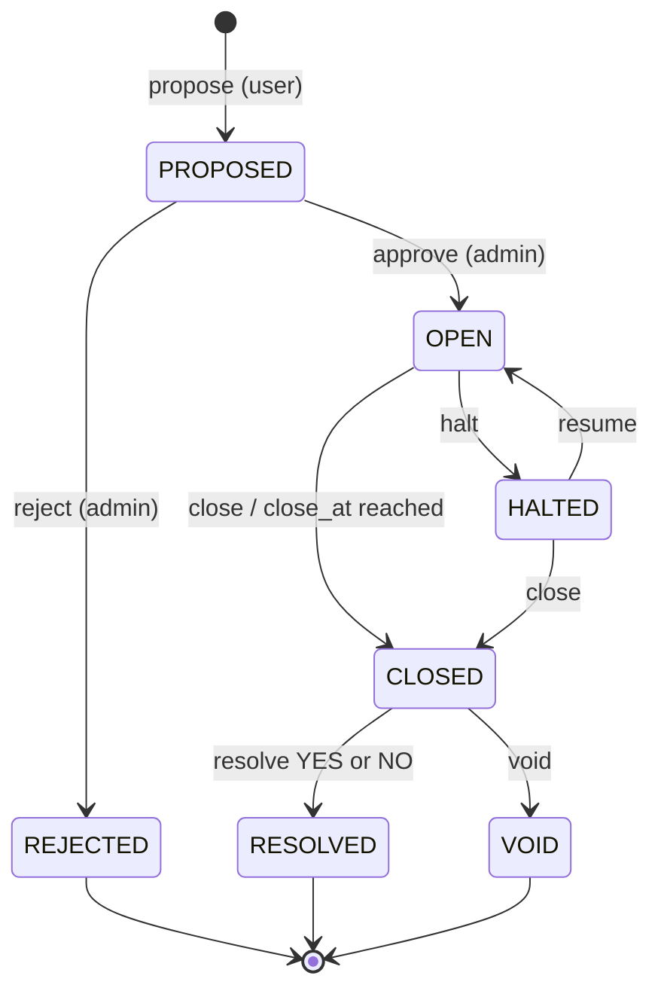
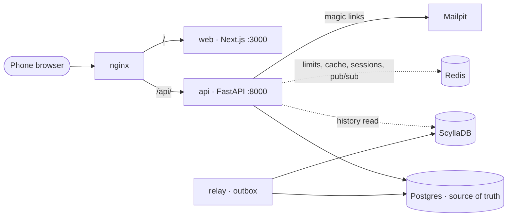

# MarkETH — Engineering Spec

Sections 1 to 12 of the hackathon spec (v2, Oct 9, 2026), kept with their original numbering so code, tests and the `CLAUDE.md` files can cite them as "SPEC §N". Decisions taken while building are collected in [Appendix A](#appendix-a-build-decisions); where the appendix and a section disagree, the appendix describes what the code does.

## 1. Overview

MarkETH is a mobile-first prediction market for ETH Zurich students, with VIS as the LMSR market maker. Users trade YES/NO shares using free vouchers; a winning share pays 1 voucher, which VIS redeems for a coffee.

Objectives, in priority order:

1. Correct pricing and accounting: no credit is created or destroyed outside an audited ledger entry.
2. Bounded VIS risk: per market, per user and in aggregate.
3. A smooth trading flow on a phone.
4. The smallest architecture that achieves 1 to 3.

Non-goals: buying vouchers with money or any other real payment, native apps, ETH SSO, multi-outcome markets, order books, limit orders and short selling.

## 2. Vouchers and voucher codes

There is one unit everywhere: 1 voucher = 1 coffee-equivalent = 1 credit (CR). The trading balance is the voucher balance, stored as BIGINT micro-units (1 CR = 1,000,000 µCR).

Credits enter only through these three sources, each booked as a ledger entry from `vis:issuance` to the user's balance:

| Source | Amount | Idempotency |
| --- | --- | --- |
| Signup grant | 5 CR when email verification succeeds | Unique `voucher_grants(user_id, 'SIGNUP')` |
| Monthly grant | 1 CR per calendar month (Europe/Zurich), from the month after signup | Unique `voucher_grants(user_id, 'YYYY-MM')` |
| Voucher code | Set by VIS per batch, 1 to 5 CR (default 1) | Code row locked; `redeemed_by` set once |

Monthly grants are created lazily on the user's next authenticated request with `INSERT … ON CONFLICT DO NOTHING`, so no cron job is needed. An admin endpoint can also grant all owed months at once.

### Voucher codes

VIS gives vouchers away by handing out codes, for example at the first-semester apéro, as quiz prizes or as a reward for good market proposals. Codes are never sold: a sold voucher would count as a paid stake under Swiss gambling law.

Creating codes (admin):

1. Create a batch with a label, the number of codes, the value per code, an expiry date and an optional rule of one redemption per user per batch.
2. The server generates each code as 12 characters of Crockford Base32 from `secrets` (60 bits), shown as `XXXX-XXXX-XXXX`. Only the SHA-256 hash is stored.
3. The plain codes are returned exactly once, as a CSV and a printable QR sheet. They cannot be shown again.
4. The batch's total value counts against `MAX_CODE_ISSUANCE_PER_MONTH` and the outstanding-obligation metric.

Redeeming a code (user):

1. The user types the code or scans its QR on the Wallet screen. The server normalizes it: uppercase, dashes removed, O read as 0, I and L read as 1.
2. In one transaction: `SELECT … FROM voucher_codes WHERE code_hash = $1 FOR UPDATE`. Reject if the code is not ACTIVE, has expired, was revoked, or the user hit the batch limit.
3. Set status REDEEMED with `redeemed_by` and `redeemed_at`, book `vis:issuance → user`, commit.
4. Unknown, used, expired and revoked codes all get the same generic error, so codes cannot be probed.
5. Rate limit via Redis: 5 attempts per user per 10 minutes and 20 per IP per hour. If Redis is down, redemption fails closed with 503.

Admins can revoke an unredeemed code or a whole batch. Codes already redeemed are not affected.

### Coffee tickets

A user turns 1 CR into a single-use coffee ticket (QR plus 8-character code): the user is debited and `vis:redemption_pending` credited. A barista scans it and marks it REDEEMED, which moves the credit to `vis:redeemed`; a second scan is rejected. Unused tickets expire after 30 days and are refunded by a compensating entry. Only whole vouchers become tickets; fractional balances stay tradeable.

## 3. Authentication and eligibility

Login is a passwordless magic link sent to an allowlisted ETH address; an account becomes ACTIVE only after that link is confirmed.

- **Allowlist:** `ALLOWED_EMAIL_DOMAINS=student.ethz.ch,ethz.ch` by default, exact match, configured server-side.
- **Normalization:** trim, NFKC, lowercase; reject `+` tags and quoted local parts. `x@student.ethz.ch` and `x@ethz.ch` map to one canonical identity `x@ethz.ch` with a unique index, so the 5-voucher signup grant cannot be claimed twice.
- **Token:** 32 random bytes, stored as a SHA-256 hash, valid 15 minutes, single use, consumed in the same transaction that creates the session.
- **Confirm step:** the link opens a page with a "Confirm sign-in" button that POSTs the token. A GET never consumes it, because mail scanners open links automatically.
- **No account probing:** "request link" always answers 202, whether or not the address exists.
- **Rate limits (Redis):** 3 links per email per 15 minutes, 20 per IP per hour, 10 verify attempts per IP per minute. Login endpoints fail closed if Redis is down.
- **Session:** opaque ID in an HttpOnly, Secure, SameSite=Lax cookie. The row lives in Postgres and is cached in Redis; it expires after 30 days, or 7 days idle. State-changing requests check the Origin header.
- **Roles:** user; admin (markets and voucher codes); barista (coffee tickets only). Admins are bootstrapped via `ADMIN_EMAILS`.
- **Mail:** local development sends to Mailpit. Do one real SMTP test before the demo.

## 4. LMSR market maker and stake limit

Each user may have at most 1 voucher at stake per market. Prices come from a binary LMSR with a default b of 10, so a full 1 CR bet moves the price from 50% to about 55%.

### Stake limit

- A user's net stake in a market = the sum of their buy costs minus the sum of their sell proceeds in that market, floored at 0.
- A buy is rejected with `LIMIT_EXCEEDED` if the net stake after the trade would exceed `MAX_STAKE_PER_USER_MARKET` (default 1 CR = 1,000,000 µCR).
- Selling is always allowed and lowers the net stake, so a user can sell and buy again up to 1 CR net.
- The trade sheet offers 0.25, 0.5 and 1 CR and shows how much stake is left in this market.

### Formulas

All functions live in one pure module, `pricing/lmsr.py`, with no I/O. Markets start at q\_yes = q\_no = 0, i.e. 50/50, with no hidden liability.

Cost, with log-sum-exp shifted by its maximum so no exponential overflows:

```latex
C(q) = b \cdot \ln\left(e^{q_{yes}/b} + e^{q_{no}/b}\right)
```

Price, computed as a complement so the two always sum to exactly 1:

```latex
p_{yes} = \frac{1}{1 + e^{(q_{no} - q_{yes})/b}}, \qquad p_{no} = 1 - p_{yes}
```

Shares x bought for a budget c, where p is the current price of the outcome bought:

```latex
x = b \left[ \ln\left(\operatorname{expm1}(c/b) + p\right) - \ln p \right]
```

Proceeds from selling s shares, the exact reverse transition:

```latex
\text{proceeds} = -b \cdot \operatorname{log1p}\left(p \cdot \operatorname{expm1}(-s/b)\right)
```

Worst-case market-maker loss per market:

```latex
L_{max} = b \ln 2
```

Users cannot sell more than they hold; short positions are rejected.

### Choosing b

The hard rule: b = budget / ln 2, rounded down to micro-units, with budget ≤ 1,000 CR. With stakes capped at 1 CR, small b values are the useful ones:

| Tier | b | Loss bound b·ln 2 | Shares for 1 CR at 50% | Price after |
| --- | --- | --- | --- | --- |
| Tight | 5 | 3.47 CR | 1.83 | 59.1% |
| Default | 10 | 6.93 CR | 1.91 | 54.8% |
| Medium | 20 | 13.86 CR | 1.95 | 52.4% |
| Maximum allowed | 1,442.695 | 1,000 CR | 2.00 | 50.03% |

### Precision and rounding

- Credits and shares are BIGINT micro-units; no floats are stored.
- Math uses `decimal.Decimal` with precision 50 and converts to integers at the edges.
- Rounding always favours the market maker: costs round up, proceeds round down, and shares bought for a budget round down. The cost is then recomputed from the rounded shares, rounded up and asserted ≤ c.
- Minimum trade: 0.01 CR or 0.01 shares. Displayed prices are rounded to 0.1 percentage points.

## 5. Risk controls

At the default b, VIS can lose at most 6.93 CR per market, so 100 open markets risk at most 693 CR instead of the 100,000 CR the 1,000-per-market ceiling would allow.

Per market: the budget is at most 1,000 CR and b is derived from it. Both are immutable while the market is OPEN. Changing them requires HALT, an admin migration, a check that b·ln 2 ≤ budget and an audit-log entry. Existing positions are never repriced.

| Control | Default | Checked at |
| --- | --- | --- |
| `MAX_STAKE_PER_USER_MARKET` | 1 CR | Every buy |
| `MAX_OPEN_MARKETS` | 100 | Approve |
| `MAX_MARKET_BUDGET` | 1,000 CR | Approve |
| `MAX_AGGREGATE_LOSS_BUDGET` (sum of b·ln 2 over OPEN and HALTED markets) | 700 CR | Approve |
| `MAX_CODE_ISSUANCE_PER_MONTH` | 200 CR | Code batch creation |
| `MAX_ORDERS_PER_MINUTE` | 10 per user | Every trade (Redis) |
| `MAX_MARKET_LIFETIME` | 90 days | Approve |
| Minimum trade | 0.01 CR | Every trade |

**Outstanding obligations** = all user balances + pending coffee tickets + for each open market max(q\_yes, q\_no) − that market's account balance. This is the most coffee VIS could owe right now. It is shown on the admin risk page, with an alert above a configurable threshold.

**Circuit breaker:** after every trade, inside the transaction, check that the ledger nets to zero, positions sum to the market's q, and no user balance is negative. On failure: roll back, set the market to HALTED in a separate transaction, and write an `alerts` row shown to admins.

## 6. Market lifecycle

A market is proposed by a user, opened by an admin, closes at its deadline and is resolved exactly once, either to an outcome or to VOID.



Admins can halt an open market and resume it; a halted market is closed before it is resolved or voided.

- **Proposal (any active user):** question; what counts as YES and NO; an objective resolution criterion; a named source or procedure; a trading close time; a resolution deadline at most 14 days after close; a requested tier. Limit: 3 proposals per user per day.
- **Approval (admin):** may edit the wording, picks the tier (which sets budget and b) and passes the aggregate caps. Approving opens the market in one atomic step.
- **Close:** trading stops at `close_at`, checked on every trade, so no cron job is needed. Admins can HALT and RESUME at any time.
- **Resolve (admin, from CLOSED; a halted market is closed first):** in one transaction, lock the market and insert a `resolutions` row; its unique `market_id` makes a second resolution impossible. Pay 1 CR per winning share from the market account to holders, book the remainder to `vis:mm_pnl`, set status RESOLVED.
- **VOID:** each user gets back their net stake in that market (at most 1 CR). Positions are zeroed and the difference is booked to `vis:mm_pnl`. The rule is shown on the market page before anyone trades.
- **Content rules:** no questions about named people's private matters, identifiable people's grades or outcomes a trader can decide alone. No party-political or religious questions, as VSETH requires Fachvereine to stay neutral there. Proposers and resolvers may not trade their own market.

## 7. Data model (PostgreSQL, Alembic)

Postgres holds every balance, position and ledger entry; all amounts are BIGINT micro-units.

| Table | Key columns |
| --- | --- |
| `users` | id, canonical\_email (unique), email, role, status, created\_at |
| `login_tokens` | id, email, token\_hash (unique), expires\_at, consumed\_at |
| `sessions` | id, user\_id, expires\_at, last\_seen\_at |
| `markets` | id (UUID), question, yes\_def, no\_def, resolution\_criteria, resolution\_source, status, budget\_micro, b\_micro, q\_yes\_micro, q\_no\_micro, version, close\_at, resolve\_by, created\_by, approved\_by |
| `positions` | (user\_id, market\_id, outcome) PK, shares\_micro, cost\_micro, proceeds\_micro |
| `trades` | id, market\_id, user\_id, side, outcome, shares\_micro, amount\_micro, p\_before, p\_after, market\_version, created\_at |
| `idempotency_keys` | (user\_id, key) PK, request\_hash, response\_json, created\_at |
| `accounts` | id, kind, owner\_id, market\_id, balance\_micro; CHECK balance ≥ 0 for user accounts |
| `journal_entries` | id, kind, ref\_type, ref\_id, idempotency\_key (unique), created\_at |
| `postings` | entry\_id, account\_id, amount\_micro; each entry sums to 0 (deferred constraint trigger) |
| `voucher_grants` | (user\_id, period) unique, entry\_id; period = 'SIGNUP' or 'YYYY-MM' |
| `voucher_code_batches` | id, label, value\_micro, count, expires\_at, one\_per\_user, created\_by, revoked\_at |
| `voucher_codes` | id, batch\_id, code\_hash (unique), status, redeemed\_by, redeemed\_at, entry\_id |
| `coffee_tickets` | id, user\_id, code\_hash (unique), status, created\_at, redeemed\_at, redeemed\_by |
| `resolutions` | market\_id (unique), outcome, evidence, resolved\_by, created\_at |
| `outbox` | id (BIGSERIAL), topic, payload JSONB, created\_at, published\_at |
| `audit_log` | id, actor\_id, action, target, before, after, created\_at |
| `alerts` | id, severity, message, context, created\_at, acked\_by |

A user's net stake in a market is `cost_micro − proceeds_micro` summed over both outcomes. `journal_entries` and `postings` are append-only: the app role has no UPDATE or DELETE on them.

System accounts: `vis:issuance` (source of all granted and coded vouchers, may go negative), `vis:mm_pnl`, `vis:redemption_pending`, `vis:redeemed`, and `market:{id}` (may go down to −budget).

## 8. Trade transaction

Every trade is one Postgres transaction that locks the market row first, so concurrent trades on a market run one after another on fresh quantities.

`POST /api/markets/{id}/trades` with header `Idempotency-Key: <uuid>` and body `{side, outcome, amount_cr | shares, max_cost_cr | min_proceeds_cr, quote_version}`:

1. Authenticate, validate with Pydantic (strict decimals, at most 6 places) and apply the Redis rate limit.
2. `BEGIN` (READ COMMITTED). Insert the idempotency key. Same key and same request hash → return the stored response; different hash → 422.
3. `SELECT … FROM markets WHERE id = $1 FOR UPDATE`, then lock the user's account. Always in this order (market, then user) to avoid deadlocks.
4. Check status OPEN and `now < close_at`. Compute cost or proceeds from the locked q with `pricing/lmsr.py`.
5. Slippage guard: cost above `max_cost` or proceeds below `min_proceeds` → `409 QUOTE_STALE` with a fresh quote.
6. For buys, check the 1 CR stake limit, the user's balance and the market's limits.
7. Write the journal entry and postings; upsert the position; insert the trade; update `q_yes`, `q_no` and `version + 1`; insert an `outbox` row `quote.updated`.
8. Check the invariants, store the response on the idempotency row, `COMMIT`.
9. After commit, best effort: delete the market's Redis cache key and publish the new quote on the Redis channel `market:{id}`.

A row lock is simpler than SERIALIZABLE here, because every trade on a market depends on that one row anyway, and it needs no retry loop.

## 9. Infrastructure

The stack: Nginx in front, Next.js and FastAPI behind it, Postgres as the only source of truth, Redis for speed and limits, ScyllaDB for price history. One `docker compose up` starts nginx, web, api, relay, postgres, redis, scylla and mailpit.



Solid arrows are required for a trade to commit; dashed arrows degrade gracefully.

If Redis or ScyllaDB fails, trades still commit in Postgres; only speed, limits and charts degrade.

### Nginx

- `/` → `web:3000`, `/api/` → `api:8000`. One origin for both, so cookies need no CORS.
- `/api/markets/*/stream` (server-sent events) with `proxy_buffering off` and a long read timeout.
- An outer `limit_req` zone per IP as a second layer behind the app's Redis limits; `client_max_body_size 64k`; gzip; security headers (HSTS when on TLS, `X-Content-Type-Options`, `Referrer-Policy`, a basic CSP).

### Redis

- **Rate limits:** fixed windows with `INCR` + `EXPIRE` for login, code redemption and trades.
- **Cache:** market list and market summaries with a 5-second TTL, deleted after every committed trade.
- **Sessions:** a read-through cache in front of the Postgres `sessions` table.
- **Live quotes:** after commit the API publishes to `market:{id}`; the SSE endpoint subscribes and pushes the new price to open phones.
- Redis never decides a balance, a price or whether a trade is allowed.

### ScyllaDB

Single node: `scylladb/scylla` with `--smp 1 --memory 750M --overprovisioned 1 --developer-mode 1`, a `cqlsh` healthcheck, keyspace `SimpleStrategy` with replication factor 1. The API starts and trades without it.

```sql
CREATE TABLE quotes_by_market_day (
  market_id uuid, day date, ts timestamp, version bigint,
  p_yes_micro bigint, q_yes_micro bigint, q_no_micro bigint, trade_id uuid,
  PRIMARY KEY ((market_id, day), ts, version)
) WITH CLUSTERING ORDER BY (ts DESC, version DESC)
  AND compaction = {'class':'TimeWindowCompactionStrategy','compaction_window_unit':'DAYS','compaction_window_size':1};
```

- The relay is its own process using `scylla-driver`. In a loop it takes up to 100 unpublished `outbox` rows with `FOR UPDATE SKIP LOCKED`, writes them to Scylla, sets `published_at` and commits. If Scylla is down nothing is marked, and the rows are retried later.
- Writes are upserts keyed by `version`, so delivering a row twice is harmless.
- `GET /api/markets/{id}/history` reads Scylla and falls back to the Postgres `trades` table when Scylla is down or behind.

### When a dependency fails

| Down | Trading | Effect |
| --- | --- | --- |
| ScyllaDB | Works | Charts fall back to Postgres; the outbox backs up and drains once Scylla is back |
| Redis | Works | Login and code redemption fail closed (503); trade rate limit falls back to in-process; cache bypassed; live updates fall back to 10-second polling |
| Postgres | Stops | Everything returns 503; nothing financial is decided anywhere else |

## 10. API

FastAPI with Pydantic models; the OpenAPI schema generates the TypeScript client. All paths sit under `/api`.

| Method | Path | Notes |
| --- | --- | --- |
| POST | `/auth/request-link` | `{email}`, always 202 |
| POST | `/auth/verify` | `{token}`, sets the session cookie, books the signup grant once |
| POST | `/auth/logout` |  |
| GET | `/me` | Profile, balance, next monthly grant date |
| GET | `/markets?status=` | List with p\_yes and volume |
| GET | `/markets/{id}` | Details, rules, deadline, price, own position and stake left |
| GET | `/markets/{id}/quote` | Query `side, outcome, amount_cr or shares`; returns cost, shares, average price, p\_after, quote\_version |
| POST | `/markets/{id}/trades` | Idempotent trade (section 8) |
| GET | `/markets/{id}/history` | Chart data, Scylla with Postgres fallback |
| GET | `/markets/{id}/stream` | SSE quote updates via Redis pub/sub |
| GET | `/me/positions`, `/me/trades`, `/me/ledger` |  |
| POST | `/markets` | Proposal |
| POST | `/vouchers/redeem-code` | `{code}`; credits the code's value |
| POST | `/coffee-tickets` | Turns 1 CR into a coffee ticket |
| POST | `/admin/markets/{id}/approve`, `reject`, `halt`, `resume`, `close`, `resolve`, `void` | Audit-logged |
| POST | `/admin/code-batches` | Creates a batch; returns plain codes once |
| POST | `/admin/code-batches/{id}/revoke` | Revokes unredeemed codes |
| GET | `/admin/risk` | Open markets, summed loss budgets, outstanding obligations, alerts |
| POST | `/barista/coffee-tickets/{code}/redeem` |  |

Errors share one shape, `{code, message, details}`, with codes `INSUFFICIENT_BALANCE`, `QUOTE_STALE`, `MARKET_NOT_OPEN`, `LIMIT_EXCEEDED`, `TRADE_TOO_SMALL`, `CODE_INVALID`, `RATE_LIMITED`.

## 11. Frontend

Next.js with TypeScript, mobile-first; the frontend only shows numbers the server returns and never computes a price or balance itself.

| Screen | Contents |
| --- | --- |
| Login | Email field → "check your inbox" → Confirm button |
| Markets | Cards with question, YES %, close date |
| Market detail | Price, live chart, rules, deadline, own position, stake left (of 1 CR) |
| Trade sheet | Bottom sheet: YES/NO toggle, 0.25 / 0.5 / 1 CR buttons, live quote (300 ms debounce) showing shares, average price and new probability, Confirm |
| Portfolio | Open positions, value at current price, resolved results |
| Wallet | Balance, ledger, "Redeem code" (typed or camera QR), "Get a coffee" ticket QR |
| Propose market | Form with all required fields |
| Admin | Approve and resolve markets, create and revoke code batches, risk panel |
| Barista | Camera scanner for coffee tickets |

Tap targets are at least 44 px. After `QUOTE_STALE` the sheet shows the new quote and asks to confirm again. The Confirm button disables itself and reuses one Idempotency-Key until a response arrives.

## 12. Tests and acceptance criteria

The demo is ready when the eight acceptance criteria below pass on a phone and the test suite is green.

### Tests (Hypothesis for property tests, Testcontainers for real Postgres)

- **Pricing:** p\_yes + p\_no = 1; start at 50/50; buying YES strictly raises p\_yes; cost equals the difference in C; shares bought for c never cost more than c; buy then sell never yields a profit; random sequences never push the market maker's loss above b·ln 2; |q|/b = 50 does not overflow.
- **Stake limit:** a buy that would take net stake above 1 CR is rejected; sell then buy again up to 1 CR net is allowed.
- **Accounting:** every journal entry sums to 0; all accounts sum to 0; market q equals the sum of positions; settlement pays exactly the winning shares; VOID refunds equal net stakes.
- **Concurrency:** 50 parallel trades on one market end consistent; one Idempotency-Key sent 10 times gives one trade.
- **Voucher codes:** the same code redeemed by 2 users in parallel succeeds once; expired, revoked and used codes fail with the same error; the one-per-user batch rule holds; the 6th attempt within 10 minutes is rate-limited; a batch above the monthly issuance cap is refused.
- **Grants:** the signup grant books once; a repeated monthly grant inserts nothing; the student./bare-domain alias does not create a second account.
- **Lifecycle and auth:** trading while HALTED or CLOSED fails; a second resolution fails; non-allowlisted domains, reused and expired tokens are rejected; non-admins get 403 on admin routes.
- **Failures:** with Scylla stopped trades succeed and the chart catches up after restart; with Redis stopped trades succeed and code redemption returns 503.

### Acceptance criteria

- [ ] A new `@student.ethz.ch` user logs in through a magic link in under a minute and sees 5 CR.
- [ ] Redeeming a VIS code raises the balance by the code's value; redeeming it again fails.
- [ ] Buying YES for 1 CR confirms at the quoted cost and moves the price from 50% to about 55%.
- [ ] A further buy in the same market is rejected with the stake limit; selling half returns the exact reverse cost, rounded down.
- [ ] A double tap on Confirm creates exactly one trade.
- [ ] Resolving pays winners exactly their winning shares; a second resolution is rejected.
- [ ] Stopping Scylla mid-demo leaves trading working; the chart backfills after restart.
- [ ] `/admin/risk` shows open markets, summed loss budgets against the cap and outstanding obligations.

---

## Appendix A: build decisions

Sections 1 to 12 say what the system must do. This appendix records how the code resolves what they leave open. Each item is a decision, not a suggestion; change one only together with its tests.

### A.1 Scope

- Built: every must-have, plus coffee tickets, the barista scanner and the printable QR sheet.
- Not built: stop-loss auto-halt and the leaderboard. Payments, password login, SSO, multi-outcome markets, order books, limit orders and short selling stay out of scope.

### A.2 API conventions

- **Amounts.** Credits and shares cross the API as decimal strings with at most 6 places (`"0.25"`). Fields are named `*_cr` for credits and `shares` for shares. JSON floats are rejected on input. The server trims trailing zeros on output, also for an amount inside the `details` of an error. A size or budget in a request has at most 9 digits before the point, an amount in a response up to 12: a budget buys more shares than it has credits, and the answer must hold them.
- **Probabilities** are JSON numbers in [0, 1], already rounded for display to `PRICE_DISPLAY_DECIMALS + 2` places. `p_no` is always `1 - p_yes` computed from the rounded value.
- **Errors** use `{code, message, details}` for every non-2xx response, including validation (422 `VALIDATION_ERROR`) and unknown routes. Codes added to the spec's seven: `INSUFFICIENT_SHARES`, `LOGIN_LINK_INVALID`, `IDEMPOTENCY_KEY_REUSED`, `VALIDATION_ERROR`, `UNAUTHENTICATED`, `FORBIDDEN`, `NOT_FOUND`, `CONFLICT`, `SERVICE_UNAVAILABLE`, `INTERNAL_ERROR`. What `details` holds for each code is listed in the `ErrorResponse` schema of the OpenAPI document; a `LIMIT_EXCEEDED` names the limit it ran into in `details.limit`. A wrong method on an existing path is 405 with code `NOT_FOUND`. With Postgres unreachable every route that needs it answers 503 `SERVICE_UNAVAILABLE` (§9); the API's error handlers translate that once, no service does.
- **Status codes.** What creates something answers 201: a market proposal, a trade, a coffee ticket, a code batch. `request-link` answers 202, `logout` 204, everything else 200.
- **Who may call what.** Public, no session needed: `/health`, `/config`, `/auth/*`, and reading markets (`GET /markets`, `/markets/{id}`, `/quote`, `/history`, `/stream`). Everything else needs a session. `/admin/*` needs role ADMIN. `/barista/*` needs role BARISTA or ADMIN. Market detail adds the viewer's position and stake only when a session is present. The OpenAPI document says this for every operation, in its `security` and its description; both are read off the guard the route uses. A SUSPENDED account is refused wherever a session is needed and has no admin or barista rights anywhere, public routes included.
- **Origin check.** Requests with a method other than GET, HEAD or OPTIONS must carry an `Origin` header listed in `ALLOWED_ORIGINS`, otherwise 403.
- **Lists** that can grow (`/me/trades`, `/me/ledger`) take `limit` and an opaque `cursor` and return `{items, next_cursor}`.
- **Endpoints added to §10:**

| Method | Path | Why |
| --- | --- | --- |
| GET | `/health` | Compose healthcheck; reports Postgres, Redis and Scylla separately |
| GET | `/config` | Public tunables for the UI, so the frontend reads no environment |
| GET | `/me/proposals` | A proposer sees the status of their proposals |
| GET | `/me/coffee-tickets` | Wallet shows pending and past tickets (never the code) |
| GET | `/admin/code-batches` | Admin lists batches with redeemed and revoked counts |
| POST | `/admin/alerts/{id}/ack` | Acknowledge an alert (`alerts.acked_by`) |
| POST | `/admin/grants/monthly` | "An admin endpoint can also grant all owed months at once" (§2) |

### A.3 Authentication

- `POST /auth/request-link` answers 422 for a malformed or non-allowlisted address (the allowlist is public knowledge) and 202 for every allowlisted address, whether or not an account exists. A mail failure is logged and still answers 202.
- The link is `{PUBLIC_BASE_URL}/login/confirm#token=<token>`. The token is in the URL fragment, so it reaches neither server logs nor mail scanners' requests. The page POSTs it to `/auth/verify`.
- Users are created at verify, never at request. Creation, the user's ledger account, the signup grant, token consumption and the session are one transaction.
- Roles are re-derived at every sign-in: ADMIN if the canonical address is in `ADMIN_EMAILS`, else BARISTA if in `BARISTA_EMAILS`, else USER. Both lists are canonicalised the same way as logins.
- The cookie holds a random session token; `sessions.id` stores its SHA-256, so a database leak leaks no sessions.
- A session is valid while `now < expires_at` (30 days) and `now < last_seen_at + 7 days`. `last_seen_at` is written back at most every `SESSION_TOUCH_INTERVAL_SECONDS`.
- Sessions are cached in Redis for `SESSION_CACHE_TTL_SECONDS`. If Redis is down, authentication reads Postgres directly; only the login endpoints and code redemption fail closed.
- **Lazy upkeep.** Whenever a session is loaded from Postgres (a cache miss), the user's owed monthly grants are booked and their expired coffee tickets refunded, in one short transaction. This replaces a cron job.
- Monthly grants: one per calendar month in `APP_TIMEZONE`, starting with the month after signup, including every month missed in between.

### A.4 Trading

- **Request modes.** Exactly one of `amount_cr` and `shares`:

| Side | Sized by | Guard field | `QUOTE_STALE` when |
| --- | --- | --- | --- |
| BUY | `amount_cr` (a budget) | `min_shares` | fewer shares than `min_shares` |
| BUY | `shares` | `max_cost_cr` | cost above `max_cost_cr` |
| SELL | `shares` | `min_proceeds_cr` | proceeds below `min_proceeds_cr` |

  `min_shares` is added because a buy by budget never costs more than the budget, so `max_cost_cr` cannot detect a moved price. SELL sized by `amount_cr` is rejected with 422. Guards are optional; `quote_version` is informational and returned in every quote. The `QUOTE_STALE` response carries a fresh quote in `details.quote`.
- **Buy by budget:** shares = floor(x), then cost = ceil(cost of those shares), asserted ≤ budget. The user pays the cost, not the budget. The two are always the same amount: a share costs less than 1 CR, so the fraction of a micro-share cut off is worth less than 1 µCR and the cost rounds back up to the budget.
- **Minimum size.** A trade sized by amount needs `amount_cr ≥ MIN_TRADE_CR`; a trade sized by shares needs `shares ≥ MIN_TRADE_SHARES`. Below that it is `TRADE_TOO_SMALL`. A buy by budget cannot yield zero shares (A.9), so there is no further case.
- **A sell that brings in nothing.** The proceeds of a sell round down, to 0 when the shares are priced below a millionth of a credit (0.01 shares below a price of 10⁻⁴). Selling is always allowed (§4), so the sell executes: position, quantities, version, trade row (amount 0) and outbox are written as for any trade, and no journal entry is booked, because it would have no postings (A.8). A buy always costs at least 1 µCR.
- **Net stake** in a market = max(0, Σ cost − Σ proceeds) over both outcomes. A buy is `LIMIT_EXCEEDED` when the net stake after it would exceed `MAX_STAKE_PER_USER_MARKET`. Sells are never limited.
- **The market's limits** (§8 step 6). A buy is checked against the stake limit and the balance only. No trade is refused for the market's sake: the LMSR bounds the market maker's loss at b · ln 2, which approval fits into the budget, and the circuit breaker verifies after every trade that the bound held.
- **Self-dealing.** The proposer of a market may not trade it (403). An admin who has traded a market may neither resolve nor void it (403): a void would refund that admin's own stake. Another admin has to settle it.
- **Effective status.** A market whose status is OPEN but whose `close_at` has passed is treated and reported as CLOSED everywhere; no job flips the column. Resolve and void first move an OPEN-past-deadline or HALTED market to CLOSED inside the same transaction, with its own audit entry. An OPEN market before its deadline must be closed explicitly first.
- **Idempotency.** The key is scoped to (user, key). The request hash covers the market id and the body. Same key and hash returns the stored response; same key and another hash is 422 `IDEMPOTENCY_KEY_REUSED`. A trade that fails rolls its key back, so the client may retry with the same key.
- **Rate limit.** `MAX_ORDERS_PER_MINUTE` per user in Redis; if Redis is unreachable, an in-process limiter with the same rule takes over.
- **Circuit breaker.** After the writes and before commit: all account balances sum to zero, the market's positions sum to its `q_yes`/`q_no`, no user balance is negative, and max(`q_yes`, `q_no`) minus the market account's balance is at most the market's budget. On failure the transaction rolls back, a second transaction sets the market HALTED and writes a CRITICAL alert, and the client gets 503.
- `markets.volume_micro` is the running sum of trade amounts (costs and proceeds).
- **Outbox.** Each trade inserts `quote.updated` with `{market_id, ts, version, p_yes_micro, q_yes_micro, q_no_micro, trade_id}`. Approval inserts the version-0 point (50%, `trade_id` null) so every chart has a start.
- **After commit, best effort:** delete the market's cache keys and the list keys, publish the new quote on Redis channel `market:{id}`. Lifecycle changes publish a status event on the same channel so open phones refetch.

### A.5 Markets

- **Tiers.** TIGHT, DEFAULT and MEDIUM fix b (`LMSR_TIER_*_B`); the budget is ceil(b · ln 2). CUSTOM takes a `budget_cr` and derives b = floor(budget / ln 2). Either way b · ln 2 ≤ budget ≤ `MAX_MARKET_BUDGET`.
- **Approval** holds a transaction-scoped advisory lock so two approvals cannot both slip under a cap. It checks: `close_at` in the future and at most `MAX_MARKET_LIFETIME` days away; `close_at ≤ resolve_by ≤ close_at + MAX_RESOLUTION_DELAY_DAYS`; fewer than `MAX_OPEN_MARKETS` markets in OPEN or HALTED; the sum of budgets over OPEN and HALTED markets plus this one within `MAX_AGGREGATE_LOSS_BUDGET`. It creates the `market:{id}` account and opens the market in the same transaction.
- **Proposal limit:** `MAX_PROPOSALS_PER_USER_PER_DAY` per calendar day in `APP_TIMEZONE`, counted in Postgres. A proposal asks for TIGHT, DEFAULT or MEDIUM; CUSTOM is for VIS to choose at approval.
- **Listing.** `GET /markets?status=` filters by effective status. Without the parameter it returns OPEN, HALTED, CLOSED, RESOLVED and VOID. PROPOSED and REJECTED are visible to admins only.
- **Resolution.** One journal entry: each holder of the winning outcome is credited their shares (1 CR per share), the market account is debited its whole balance, and `vis:mm_pnl` takes the difference, which may be negative. Positions keep their shares as a record.
- **VOID.** One journal entry: each user is credited their net stake, the market account is debited its whole balance, `vis:mm_pnl` takes the difference. Shares in all positions and the market's `q_yes`/`q_no` are set to zero; `cost_micro` and `proceeds_micro` stay as a record. The VOID rule is part of the market detail response.
- **Settlement locks** the market row, then the accounts of the users it pays, all at once in ascending account id order, then the market and VIS accounts. Positions need no lock of their own: every writer of a market's positions holds the market row.
- Every admin action writes an `audit_log` row in its transaction. The one exception is the monthly grant run (`POST /admin/grants/monthly`): it uses one transaction per user, so that a failure costs one user, and writes its audit row afterwards, with the number of users that failed. Each grant is a journal entry of its own either way.

### A.6 Vouchers and coffee tickets

- **Code batches.** The plain codes are returned once, in the JSON response of batch creation. The CSV and the printable QR sheet are produced in the browser from that response; the server cannot reproduce them.
- **Issuance cap.** The value of all non-revoked codes created in the current calendar month plus the new batch must not exceed `MAX_CODE_ISSUANCE_PER_MONTH`. Batch creation holds an advisory lock for the check.
- **QR payload** of a code card is `{PUBLIC_BASE_URL}/wallet#code=XXXX-XXXX-XXXX`. A phone camera opens the wallet with the code prefilled; the in-app scanner accepts both that URL and a bare code. Either way the browser cuts the code out of the fragment and sends the code alone: the server takes no URL, and one posted whole is `CODE_INVALID` like any other text that is not a code.
- **Redemption** locks the code row, then the user's account. The one-per-user rule is checked under the account lock, so two parallel redemptions by one user cannot both pass. Breaking it is `LIMIT_EXCEEDED`, not `CODE_INVALID`: the user holds a valid code and should learn why it was not taken.
- **Revocation** with a list of plain codes revokes those; without a list it revokes every unredeemed code of the batch and stamps `revoked_at`.
- **Coffee tickets.** The 8-character code is shown once at issue; the wallet keeps it in the browser's local storage so the QR can be shown again. `coffee_tickets.expires_at` is set at issue. A bad, used or expired ticket gets the generic `CODE_INVALID`. An expired ticket is refunded by lazy upkeep (A.3) or when a barista scans it, whichever happens first. Every operation on a ticket locks its owner's account first and the ticket row second.
- **Risk page.** Outstanding obligations follow the §5 formula, with "each open market" read as every market that is not yet settled (OPEN, HALTED or CLOSED): a closed market still owes its payout. The "alert above a configurable threshold" is a flag in the response (`above_threshold`) that the page shows as a warning; reading the page writes no `alerts` row, which only the circuit breaker does. The value of unredeemed, unexpired codes is reported next to the obligations as its own figure, because §2 counts it but the §5 formula does not.

### A.7 Data model additions

Columns the spec implies but does not list:

| Table | Added | Reason |
| --- | --- | --- |
| `markets` | `requested_tier`, `tier`, `volume_micro`, `rejection_reason`, `created_at`, `opened_at`, `closed_at` | Proposal, listing and audit needs |
| `trades` | `p_yes_before_micro`, `p_yes_after_micro` instead of `p_before`, `p_after` | No floats stored; always the YES price |
| `coffee_tickets` | `expires_at`, `value_micro` | 30-day expiry; the amount to redeem or refund, fixed at issue |
| `voucher_code_batches`, `voucher_grants`, `login_tokens`, `sessions` | `created_at` | Monthly cap, audit |
| `alerts` | `acked_at` | Acknowledgement |
| `postings` | `id` | Surrogate key and ledger cursor |
| `journal_entries` | `created_xid` | The transaction that created the entry; only it may add postings |

Row locks ("`FOR UPDATE`" in §2 and §8) are taken as `FOR NO KEY UPDATE`: it serialises writers the same way, but does not block another transaction from inserting a row that references the locked one, which a plain `FOR UPDATE` would. Hash columns carry a CHECK that accepts only a 64-character lowercase SHA-256 hex string; that includes `idempotency_keys.request_hash`. A timestamp without a timezone is refused before it reaches the database.

What the database enforces beyond §7, so that a bug in a service fails loudly instead of bending the books:

- **Balances.** `accounts.balance_micro` is kept by the database: a trigger adds every posting to its account. The app role cannot write the column, open an account with a balance or delete an account. A balance therefore cannot move without a posting, and a posting cannot be booked without its balance.
- **Sealed entries.** Only the transaction that created a journal entry can add postings to it. Together with the missing UPDATE and DELETE this makes a committed entry immutable.
- **Floors.** User accounts cannot go negative (§7). Neither can a market account nor `vis:redemption_pending` and `vis:redeemed`. §7 says a market account "may go down to −budget"; with the postings of A.8 it never goes below zero, because it only takes in costs and pays out proceeds. What can reach −budget is the market's result, which `vis:mm_pnl` takes at settlement. `vis:issuance` and `vis:mm_pnl` may go negative.
- **Markets.** b · ln 2 ≤ budget is a CHECK. Budget and b cannot be changed while a market is OPEN (§5); approval sets them in the UPDATE that opens it.
- **Trades.** `(market_id, market_version)` is unique: every trade of a market has its own version (§8), and the chart is keyed by it (§9).

A CHECK constraint or the member list of an enum column is changed by a hand-written migration that drops and re-creates the constraint. Autogenerate does not compare CHECK constraints; a test compares what the models define with what the migrations built.

`markets.budget_micro` and `b_micro` are 0 until approval. Enum-like columns are VARCHAR with a CHECK constraint. Primary keys are UUIDv7 except `outbox`, `postings`, `audit_log` and `alerts`, which use BIGINT identity. `sessions.id` is the SHA-256 hex of the session token.

### A.8 Ledger entries

A positive posting increases an account's balance. Every entry sums to zero. `journal_entries.idempotency_key` is deterministic, so a replay cannot book twice.

| Kind | Postings | `idempotency_key` |
| --- | --- | --- |
| `SIGNUP_GRANT` | `vis:issuance` −g, user +g | `grant:{user_id}:SIGNUP` |
| `MONTHLY_GRANT` | `vis:issuance` −g, user +g | `grant:{user_id}:{YYYY-MM}` |
| `CODE_REDEMPTION` | `vis:issuance` −v, user +v | `code:{code_id}` |
| `TRADE_BUY` | user −cost, market +cost | `trade:{trade_id}` |
| `TRADE_SELL` | market −proceeds, user +proceeds | `trade:{trade_id}` |
| `MARKET_RESOLUTION` | each winner +shares, market −B, `vis:mm_pnl` +(B − Σ payouts) | `resolution:{market_id}` |
| `MARKET_VOID` | each user +net stake, market −B, `vis:mm_pnl` +(B − Σ refunds) | `void:{market_id}` |
| `COFFEE_TICKET_ISSUE` | user −t, `vis:redemption_pending` +t | `ticket:{ticket_id}:issue` |
| `COFFEE_TICKET_REDEEM` | `vis:redemption_pending` −t, `vis:redeemed` +t | `ticket:{ticket_id}:redeem` |
| `COFFEE_TICKET_REFUND` | `vis:redemption_pending` −t, user +t | `ticket:{ticket_id}:refund` |

B is the market account's balance at that moment. Zero-amount postings are omitted; an entry all of whose postings would be zero is not booked at all (a market nobody traded, a sell whose proceeds round down to nothing).

### A.9 Pricing module interface

`backend/app/pricing/lmsr.py` works on integer micro-units and uses `Decimal` internally. Every function takes `precision` (from `PRICING_DECIMAL_PRECISION`) as a keyword argument defaulting to 50. `PRICING_DECIMAL_PRECISION` must be at least 50, the value §4 names: with 28 to 32 digits, quotes at the largest b of §4 were shown to round against the market maker.

```python
@dataclass(frozen=True, slots=True)
class MarketState:
    q_yes: int   # µshares
    q_no: int    # µshares
    b: int       # µCR

@dataclass(frozen=True, slots=True)
class TradeQuote:
    side: TradeSide
    outcome: Outcome
    shares_micro: int
    amount_micro: int          # cost of a buy (rounded up) or proceeds of a sell (rounded down)
    before: MarketState
    after: MarketState
    p_yes_before_micro: int
    p_yes_after_micro: int

def price_yes(state) -> Decimal                      # in [0, 1]
def price_yes_micro(state) -> int
def cost(state) -> Decimal                           # C(q) in µCR
def quote_buy_for_budget(state, outcome, budget_micro) -> TradeQuote
def quote_buy_shares(state, outcome, shares_micro) -> TradeQuote
def quote_sell_shares(state, outcome, shares_micro) -> TradeQuote
def max_loss_micro(b_micro) -> int                   # ceil(b · ln 2)
def b_from_budget_micro(budget_micro) -> int         # floor(budget / ln 2)
```

A buy for a budget charges exactly the budget (`amount_micro == budget_micro`) and yields at least as many µshares as the budget has µCR, because a share costs less than 1 CR. A quote of zero shares therefore cannot occur, and no caller needs a branch for it. A sell can return `amount_micro == 0` (A.4).

Negative or zero inputs raise `ValueError`. So does a b too large for the precision: the quote functions accept b³ up to 10^(precision − 17), which is 10¹¹ µCR at 50 digits, seventy times the largest b of §4. An argument of the wrong type raises `TypeError`: quantities, sizes and b are `int`, and an outcome is a member of `Outcome`, not a string equal to one.

### A.10 Infrastructure

- Compose adds a one-shot `migrate` service (Alembic as the owner role). `api` and `relay` wait for it and for Postgres; neither waits for Redis or Scylla.
- Two Postgres roles: the owner (`POSTGRES_USER`) runs migrations; the app role (`POSTGRES_APP_USER`) is created by the baseline migration if missing, gets SELECT, INSERT, UPDATE, DELETE on everything, and then loses UPDATE and DELETE on `journal_entries` and `postings`. On `accounts` it keeps only SELECT, INSERT of a new account without a balance, and the right to lock a row; on `journal_entries` it cannot set `created_xid` (A.7).
- `docker compose up` merges `compose.override.yaml` and gives hot reload and published ports. `docker compose -f compose.yaml up --build` runs the production-like images.
- The relay creates the keyspace and table if missing, so a wiped Scylla heals itself.
- The camera and Secure cookies need HTTPS. For a phone demo, expose port 8080 through an HTTPS tunnel and set `PUBLIC_BASE_URL`, `ALLOWED_ORIGINS` and `SESSION_COOKIE_SECURE=true`. TLS termination is not part of this repository.

### A.11 Frontend

- Polymarket's layout in ETH Zurich's palette; the full system is in `frontend/DESIGN.md`. Light theme only. No ETH logo; the wordmark is "MarkETH". Headings and numbers use Barlow, body text Inter, because ETH's DIN Next is licensed.
- The frontend reads no environment variables. Tunables come from `GET /api/config`.
- Stake presets come from the market detail response with an `allowed` flag each, so the UI never compares amounts itself. So do sell presets: for each outcome, half of the viewer's holding (rounded down to a millionth of a share) and all of it, as the number of shares to send, with an `allowed` flag. The wallet enables "Get a coffee" from `can_get_coffee` in `GET /me`.

