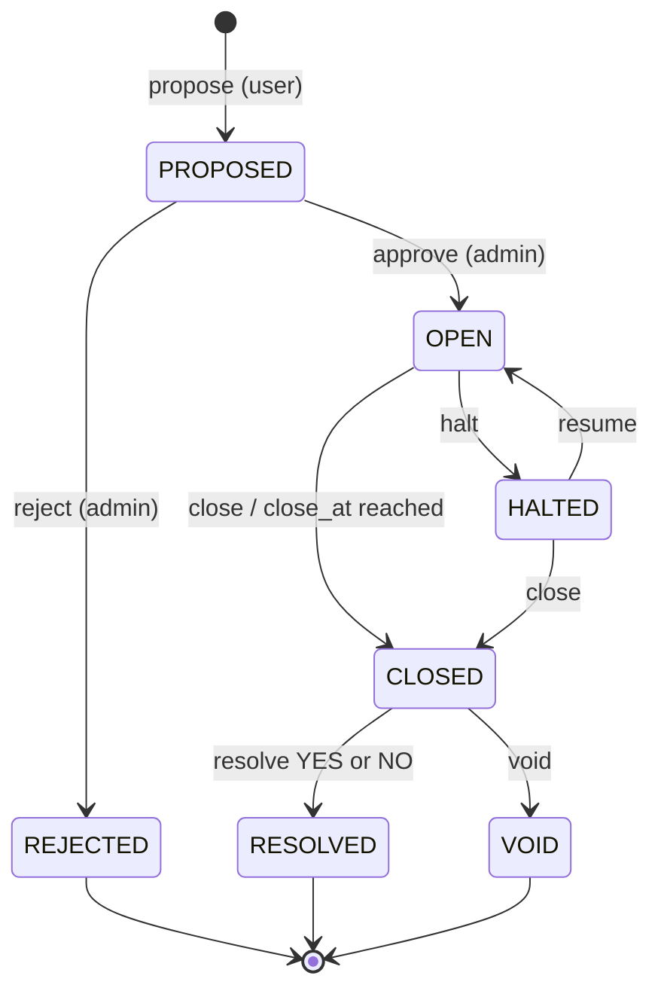
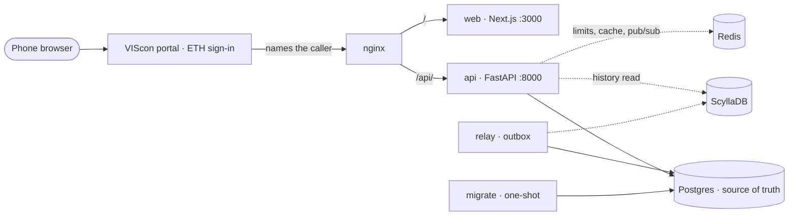

# MarkETH: engineering spec

The engineering specification of MarkETH as it is built. Sections 1 to 12 say what the system does; [Appendix A](#appendix-a-build-decisions) records the decisions behind it, each with its reason. Code, tests and the `CLAUDE.md` files cite both by number ("SPEC §8", "A.4"), so the numbering is fixed.

Every tunable is a setting of `.env` and is written here as `NAME=value`, with the value of `.example.env`. Amounts are in CR: 1 CR is one credit. On screen a credit is a "token"; "credit", "CR" and `*_cr` are its names in the code, the API, the database and this document.

## 1. Overview

MarkETH is a mobile-first prediction market for ETH Zurich students, with VIS as the LMSR market maker. Users trade YES/NO shares with free credits; a winning share pays 1 credit, and credits buy vouchers for products at the bar: a coffee, a drink, a snack. No real money is involved anywhere.

The app runs on one VM behind the VIScon portal, which signs every visitor in through ETH single sign-on and tells the app who is calling (§3, §9).

Objectives, in priority order:

1. Correct pricing and accounting: no credit is created or destroyed outside an audited ledger entry.
2. Bounded VIS risk: per market, per user and in aggregate.
3. A smooth trading flow on a phone.
4. The smallest architecture that achieves 1 to 3.

Non-goals: buying credits, codes or vouchers with money or any other real payment, native apps, a sign-in of its own, multi-outcome markets, order books, limit orders and short selling.

## 2. Tokens, grants, codes and vouchers

There is one unit everywhere: the credit (CR), on screen a token. The balance a user trades with is the balance that buys vouchers, stored as BIGINT micro-units (1 CR = 1,000,000 µCR). Shares use the same scale, because a winning share pays 1 CR.

| Concept | Code, API, database | On screen |
| --- | --- | --- |
| The unit | credit, `*_cr`, µCR | token, with a coffee-bean icon |
| Free credits by rule | grant: table `grants`, periods `SIGNUP` and `YYYY-MM` | "Welcome tokens", "Monthly tokens" |
| Free credits by code | code: tables `code_batches` and `codes`, `POST /codes/redeem` | "Redeem code" |
| What credits buy | voucher: table `vouchers`, `POST /vouchers`, the barista's scan | "voucher" |
| What a voucher is for | product: one entry of `VOUCHER_PRODUCTS` | the product's name |

Free credits are handed out through these three sources, each booked as a ledger entry from `vis:issuance` to the user's balance:

| Source | Amount | Idempotency |
| --- | --- | --- |
| Signup grant | `SIGNUP_GRANT_CR=500`, with the profile (§3) | Unique `grants(user_id, 'SIGNUP')` |
| Monthly grant | `MONTHLY_GRANT_CR=200` on every monthly anniversary of the sign-up | Unique `grants(user_id, 'YYYY-MM')` |
| Code | Set by VIS per batch, from `CODE_MIN_VALUE_CR=5` to `CODE_MAX_VALUE_CR=500` (`CODE_DEFAULT_VALUE_CR=35` when a batch names none) | Code row locked; `redeemed_by` set once |

An admin can also correct a balance by hand, within a cap (§5). Whatever else a user holds came out of a market.

### Grants

A user's monthly grants follow their sign-up. Grant number k falls due k calendar months after `users.created_at`, on the same day of the month and at the same time of day on the calendar of `APP_TIMEZONE=Europe/Zurich`. A month that has no such day takes its last day: signed up on 31 January, the grants fall due on 28 February, 31 March and 30 April. The period key of a grant is the `YYYY-MM` of the month it falls due in, so every calendar month after the one of the sign-up brings exactly one grant.

Monthly grants are created lazily on the user's next request with `INSERT … ON CONFLICT DO NOTHING`, so no cron job is needed (A.3). Every grant that has fallen due is owed, also those of months in which the user never came by. An admin endpoint books everything that has fallen due for every active user at once (`POST /admin/grants/monthly`). `GET /me` tells a user when the next one falls due (`next_monthly_grant_at`).

`APP_TIMEZONE` is the calendar of everything that is counted in days or months: when a grant falls due, the month of the issuance cap below, and the day of the proposal limit (§6).

### Codes

VIS gives credits away by handing out codes, for example at the first-semester apéro, as quiz prizes or as a reward for good market proposals. Codes are never sold: a sold code would count as a paid stake under Swiss gambling law.

Creating codes (admin):

1. Create a batch with a label, the number of codes, the value per code, an expiry date and an optional rule of one redemption per user per batch.
2. The server generates each code as `CODE_LENGTH=12` characters of Crockford Base32 from `secrets` (60 bits), shown as `XXXX-XXXX-XXXX`. A code is found by its SHA-256 hash. While a code is ACTIVE its row also keeps the code itself; the statement that redeems or revokes a code clears it.
3. The answer that creates a batch holds its plain codes. `GET /admin/code-batches/{batch_id}/codes` returns the codes of a batch that can still be redeemed, each with the link of its card, so an admin can open a batch again and print it. Every such read writes an audit row. The CSV and the printable QR sheet are made in the browser from either answer.
4. The batch's total value counts against the monthly cap `MAX_CODE_ISSUANCE_PER_MONTH=7000`. The value of the codes that can still be redeemed is reported on the risk page beside the outstanding obligations (§5).

Redeeming a code (user):

1. The user types the code or scans its QR on the Wallet screen. The server normalizes it: uppercase, dashes and whitespace removed, O read as 0, I and L read as 1.
2. In one transaction: `SELECT … FROM codes WHERE code_hash = $1 FOR UPDATE`, then the user's account. Reject if the code is not ACTIVE, has expired, is revoked, or the user hit the batch limit.
3. Set status REDEEMED with `redeemed_by` and `redeemed_at`, book `vis:issuance → user`, commit.
4. Unknown, used, expired and revoked codes all get the same generic error (`CODE_INVALID`), so codes cannot be probed.
5. Rate limit via Redis: `CODE_REDEEM_LIMIT_PER_USER=5` attempts per user per `CODE_REDEEM_LIMIT_PER_USER_WINDOW_SECONDS=600`. If Redis is down, redemption fails closed with 503.

Two kinds of account do not redeem, each answered 403 with a sentence that says why: an account whose role in effect is ADMIN redeems no code, and the creator of a batch redeems none of its codes. Users and baristas redeem.

Admins can revoke an unredeemed code or a whole batch. Codes already redeemed are not affected.

### Vouchers

A user turns credits into a voucher for one product. `VOUCHER_PRODUCTS` lists the products and what a voucher for each takes, in the order the wallet offers them:

| Product | CR |
| --- | --- |
| Coffee, Mate, Softdrinks, Redbull, Iced Tea | 35 |
| Tea | 30 |
| Twix, Snickers, M&Ms | 15 |
| Chewing Gum | 20 |
| Toblerone | 5 |

- **Issue.** `POST /vouchers` names a product. The user is debited its price and `vis:redemption_pending` credited. The voucher row keeps what the product is at that moment: its id (the slug of its name: "Iced Tea" is `iced-tea`), its name and its price. Every later entry moves that stored price, whatever `VOUCHER_PRODUCTS` says by then. The answer holds the voucher's code: `VOUCHER_CODE_LENGTH=8` characters of Crockford Base32, shown as `XXXX-XXXX`, which is also the content of its QR. Only its hash is stored.
- **Code replacement.** `POST /vouchers/{voucher_id}/code` gives an active, unexpired voucher of the caller a fresh code; the one it had stops working. This is how a voucher's code is shown again: the server keeps no code it could repeat.
- **The scan.** A barista, or an admin, scans the voucher (`POST /barista/vouchers/redeem`) and marks it REDEEMED, which moves the credit to `vis:redeemed`; a second scan is rejected. One case is not a second scan: the barista who redeemed a voucher is shown that redemption again, marked `repeat`, when they scan it once more within `VOUCHER_RESCAN_SECONDS=120`, because the answer to a scan can get lost on the way. Nothing is booked for a repeat.
- **Expiry.** An unused voucher expires after `VOUCHER_EXPIRY_DAYS=30` and is refunded by a compensating entry, by lazy upkeep (A.3) or when a barista scans it, whichever happens first.
- **What a balance covers.** `GET /vouchers/products` says per product whether the caller's balance covers it (`affordable`), and `GET /me` whether it covers the cheapest one (`can_get_voucher`). A voucher is for one whole product; whatever a balance holds beside that stays tradeable.

A code and a voucher's code never travel in a path. The link of a code card holds its code in the query (`/wallet?code=…`), which the proxy keeps out of its access log (§9).

Vouchers and codes are never sold, and no screen or sentence suggests a payment.

## 3. Identity, profiles, roles and the usage policy

MarkETH has no sign-in of its own. The VIScon portal in front of it signs every visitor in through ETH single sign-on and names them in two request headers; a person becomes a user by saving a profile.

- **What is trusted.** The headers `IDENTITY_HEADER_USER_ID=X-User-Id` and `IDENTITY_HEADER_USER_NAME=X-User-Name`. They are plain text, not signed. They can be believed because only the portal reaches the stack's port, and the portal puts its own values in place of any such header a client sends (`docs/SERVER_INFRASTRUCTURE.md` §3.4). `authenticate_request` in `backend/app/api/deps.py` is the one place where they are read. The proxy hands them to the API as they arrived and to the web app not at all.
- **The id rule.** An id is accepted when it is ASCII and, in lower case, exactly `[a-z0-9][a-z0-9._-]{0,63}@<domain>`, the domain being one of `ALLOWED_EMAIL_DOMAINS=ethz.ch`. Nothing is trimmed, folded or rewritten. An id is an account: the same name at two allowed domains would be two accounts. Any other id is answered 403 `FORBIDDEN` with `details.allowed_domains`.
- **Nobody is named** when the id header is absent, blank or sent more than once: 401 `UNAUTHENTICATED`.
- **The display name** is `X-User-Name` percent-decoded, without control and format characters, with its whitespace collapsed, cut to 200 characters. A name header that is absent or sent more than once is no name.
- **Nothing is remembered between requests.** Postgres is asked every time, so a profile, a role and a suspension hold from the person's next request on. The API sets and reads no cookie.
- **Profile.** `PUT /me/profile` creates the `users` row, the ledger account and the signup grant in one transaction, and later changes the username and the degree. A profile states:
  - a unique username of lower-case letters, digits and underscores, `USERNAME_MIN_LENGTH=3` to `USERNAME_MAX_LENGTH=20` characters long (the column takes 32). The names of `RESERVED_USERNAMES` are refused, so that no account passes for an official one;
  - a degree: one of six levels (`BACHELOR`, `MASTER`, `DOCTORATE`, `CONTINUING_EDUCATION`, `TEACHER_EDUCATION`, `OTHER`) and a programme of that level from the catalogue in `backend/app/core/degrees.py`, which `GET /config` serves;
  - with the save that creates it, `policy_accepted: true`, stored as `users.policy_accepted_at`.

  A caller the portal named who has no profile gets 403 `PROFILE_REQUIRED`, with their name and address in `details`, from every operation but this one. A username somebody else holds is 409 `USERNAME_TAKEN`.
- **Roles.** `users.role` is USER, ADMIN or BARISTA: USER when the profile is created, and whatever an admin sets after that. An admin runs markets, codes, users and the risk page; a barista redeems vouchers, and so can an admin. `ADMIN_EMAILS` is the bootstrap list (`ADMIN_EMAILS=admin@ethz.ch` in development): an address in it is an admin whatever its row says, also before it has a profile, and no admin can change its role or suspend it. Each entry is read by the id rule, and one the rule refuses fails startup.
- **User management.** An admin lists the users (search by username, name or address; filter by role and status), suspends and reinstates an account with a reason, sets a role and adjusts a balance (§5). The four changes are audit-logged, and an admin can make none of them to their own account.
- **Suspension.** `users.status` is ACTIVE or SUSPENDED. A suspended account is refused with 403 wherever an identity is needed and has none of the rights of its role (A.3).
- **Usage policy.** The app has a `/policy` page. Accepting it is required to create a profile and again with every market proposal (§6).
- **Origin check.** State-changing requests check the Origin header against `ALLOWED_ORIGINS` (A.2).
- **Development identity.** On a laptop nobody signs in. `compose.override.yaml` mounts `infra/nginx/dev`, which sets the two headers itself, in place of whatever a client sent: from the cookies `dev_user_id` and `dev_user_name`, and without them from `DEV_USER_ID=admin@ethz.ch` and `DEV_USER_NAME=Ada%20Admin`. A page at `/__dev/identity` switches between people. The backend has no development bypass. The stand-in cannot reach the VM: the deployed stack is `compose.yaml` alone, which mounts no such directory; `make deploy` sends neither the override nor `infra/nginx/dev` and removes both on the VM; the deployed `.env` leaves both variables empty, without which the override refuses to start; and `make deploy-check` fails on any trace of it in the tree or in the running proxy. In development the proxy is published on `NGINX_HTTP_BIND=127.0.0.1` alone, so it names a caller to nobody but the machine it runs on.

## 4. LMSR market maker and stake limit

Each user may have at most 100 CR at stake per market (`MAX_STAKE_PER_USER_MARKET=100`). Prices come from a binary LMSR with a default b of 1,000 CR (`LMSR_TIER_DEFAULT_B=1000`), so a full 100 CR bet moves the price from 50% to about 55%.

### Stake limit

- A user's net stake in a market = the sum of their buy costs minus the sum of their sell proceeds in that market, floored at 0.
- A buy is rejected with `LIMIT_EXCEEDED` if the net stake after the trade would exceed `MAX_STAKE_PER_USER_MARKET`.
- Selling is always allowed and lowers the net stake, so a user can sell and buy again up to 100 CR net.
- The trade sheet offers the buy buttons `TRADE_STAKE_PRESETS_CR=25,50,100`, a slider with a number field, and shows how much stake is left in this market. The API says where the slider runs for the viewer: `buy_slider` of the market detail is `{min, max, step}` in whole credits. The step is `TRADE_STAKE_STEP_CR=1`, `min` the smallest multiple of the step that is a trade, `max` the largest multiple that both the stake left and the balance cover; it is null when the viewer cannot buy.
- The trade sheet offers the same for a sale: a slider with a number field for the shares to sell, and the sell buttons for half and all of the holding. `sell` of the market detail says per outcome where that slider runs, `{min, max, step}` in whole shares. The step is `TRADE_SHARE_STEP=1`, `min` the smallest multiple of the step that is a trade (`MIN_TRADE_SHARES`), `max` the largest multiple the viewer holds of the outcome; it is null when the viewer holds less than that or cannot trade. What is held beyond a whole share is sold with the button for all.
- A quote is about the caller. `GET /markets/{market_id}/quote` answers with the figures of a trade the caller could make, and otherwise with the error the trade would get, so an amount somebody types is judged by the server (A.4).

### Formulas

All functions live in one pure module, `pricing/lmsr.py`, with no I/O. Markets start at q\_yes = q\_no = 0, i.e. 50/50, with no hidden liability.

Cost, with log-sum-exp shifted by its maximum so no exponential overflows:

```latex
C(q) = b \cdot \ln\left(e^{q_{yes}/b} + e^{q_{no}/b}\right)
```

Price, computed as a complement so the two always sum to exactly 1:

```latex
p_{yes} = \frac{1}{1 + e^{(q_{no} - q_{yes})/b}}, \qquad p_{no} = 1 - p_{yes}
```

Shares x bought for a budget c, where p is the current price of the outcome bought:

```latex
x = b \left[ \ln\left(\operatorname{expm1}(c/b) + p\right) - \ln p \right]
```

Proceeds from selling s shares, the exact reverse transition:

```latex
\text{proceeds} = -b \cdot \operatorname{log1p}\left(p \cdot \operatorname{expm1}(-s/b)\right)
```

Worst-case market-maker loss per market:

```latex
L_{max} = b \ln 2
```

Users cannot sell more than they hold; short positions are rejected.

### Choosing b

The hard rule: b = budget / ln 2, rounded down to micro-units, with budget ≤ 5,000 CR (`MAX_MARKET_BUDGET=5000`). Three fixed tiers set b directly: `LMSR_TIER_TIGHT_B=500`, `LMSR_TIER_DEFAULT_B=1000` and `LMSR_TIER_MEDIUM_B=2000`. The table has a row for each of them and one for the largest b a market can have:

| Tier | b | Loss bound b·ln 2 | Shares for 100 CR at 50% | Price after |
| --- | --- | --- | --- | --- |
| Tight | 500 | 346.57 CR | 183.29 | 59.1% |
| Default | 1,000 | 693.15 CR | 190.90 | 54.8% |
| Medium | 2,000 | 1,386.29 CR | 195.24 | 52.4% |
| Largest allowed | 7,213.475204 | 5,000 CR | 198.63 | 50.7% |

How much liquidity a market has is VIS's business: a proposal names none, the admin picks the tier at approval, and a market tells its tier, its b and its loss budget to admins alone (A.5).

### Precision and rounding

- Credits and shares are BIGINT micro-units; no floats are stored.
- Math uses `decimal.Decimal` with precision 50 (`PRICING_DECIMAL_PRECISION=50`) and converts to integers at the edges.
- Rounding always favours the market maker: costs round up, proceeds round down, and shares bought for a budget round down. The cost is then recomputed from the rounded shares, rounded up and asserted ≤ c.
- Minimum trade: 1 CR when a trade is sized by amount (`MIN_TRADE_CR=1`), 1 share when it is sized by shares (`MIN_TRADE_SHARES=1`). Displayed prices are rounded to 0.1 percentage points (`PRICE_DISPLAY_DECIMALS=1`).

## 5. Risk controls

At the default b, VIS can lose at most 693.15 CR per market, so `MAX_OPEN_MARKETS=100` open markets risk at most 69,314.72 CR instead of the 500,000 CR the 5,000-per-market ceiling would allow.

Per market: the budget is at most `MAX_MARKET_BUDGET` and b is derived from it, or set by a tier whose loss bound is then the budget. Both are immutable while the market is OPEN: the database refuses the change. Changing them requires HALT, and whatever is written has to keep b·ln 2 ≤ budget, which a CHECK holds. No operation of the API makes such a change. Existing positions are never repriced.

| Control | Setting | Checked at |
| --- | --- | --- |
| Stake per user and market | `MAX_STAKE_PER_USER_MARKET=100` (CR) | Every buy and every quote of one |
| Open markets | `MAX_OPEN_MARKETS=100` | Approve |
| Budget of one market | `MAX_MARKET_BUDGET=5000` (CR) | Approve |
| Sum of the budgets of OPEN and HALTED markets, each of which covers its b·ln 2 | `MAX_AGGREGATE_LOSS_BUDGET=70000` (CR) | Approve |
| Code value issued per calendar month | `MAX_CODE_ISSUANCE_PER_MONTH=7000` (CR) | Code batch creation |
| Trades per user per minute | `MAX_ORDERS_PER_MINUTE=10` | Every trade (Redis) |
| Days between approval and `close_at` | `MAX_MARKET_LIFETIME=90` | Propose and approve |
| Credits one adjustment adds to a balance | `MAX_ADMIN_ADJUSTMENT_CR=1000` | Every admin adjustment |
| Minimum trade | `MIN_TRADE_CR=1`, `MIN_TRADE_SHARES=1` | Every trade and quote |

**Admin adjustments.** An admin credits or debits a user's balance with a signed, non-zero amount and a reason. It is booked against `vis:issuance` as its own kind of ledger entry, is idempotent by its `Idempotency-Key` (§10) and is audit-logged. One adjustment adds at most `MAX_ADMIN_ADJUSTMENT_CR`, and more is refused with `LIMIT_EXCEEDED`; what an adjustment takes away is bounded by the balance. No admin adjusts their own account. The risk page shows the net of the month's adjustments.

**Outstanding obligations** = all user balances + pending vouchers + for each open market max(q\_yes, q\_no) − that market's account balance. This is the most VIS could owe right now. "Each open market" means every market that is not settled yet: OPEN, HALTED or CLOSED (A.6). It is shown on the admin risk page, with an alert above a configurable threshold (`OBLIGATIONS_ALERT_THRESHOLD_CR=100000`).

**Circuit breaker:** after every trade, inside the transaction, check that the ledger nets to zero, positions sum to the market's q, no user balance is negative and the market could not lose more than its budget. On failure: roll back, set the market to HALTED in a separate transaction, and write an `alerts` row shown to admins.

**Audit log:** every admin action writes an `audit_log` row in its transaction, with who acted and the state before and after (A.5).

## 6. Market lifecycle

A market is proposed by a user, opened by an admin, closes at its deadline and is resolved exactly once, either to an outcome or to VOID.



Admins can halt an open market and resume it; a halted market is closed before it is resolved or voided.

- **Proposal (any active user):** question; what counts as YES and NO; an objective resolution criterion; a named source or procedure; a trading close time at most `MAX_MARKET_LIFETIME=90` days ahead; a resolution deadline at most `MAX_RESOLUTION_DELAY_DAYS=14` days after close; and `policy_accepted: true`, the proposer's acceptance of the usage policy for this proposal. A proposal says nothing about liquidity. Limit: `MAX_PROPOSALS_PER_USER_PER_DAY=3` proposals per user per day.
- **Approval (admin):** may edit the wording and the two dates, picks the tier (which sets budget and b) and passes the aggregate caps. Approving opens the market in one atomic step.
- **Close:** trading stops at `close_at`, checked on every trade, so no cron job is needed. Admins can HALT a market that trades and RESUME a halted one.
- **Resolve (admin, from CLOSED; a halted market is closed first):** in one transaction, lock the market and insert a `resolutions` row; its unique `market_id` makes a second resolution impossible. Pay 1 CR per winning share from the market account to holders, book the remainder to `vis:mm_pnl`, set status RESOLVED.
- **VOID:** each user gets back their net stake in that market, which is at most the stake limit. Positions are zeroed and the difference is booked to `vis:mm_pnl`. The rule is shown on the market page before anyone trades.
- **Who settles:** only an admin resolves or voids a market, and not an admin who traded it. Another admin has to (A.4).
- **Content rules:** the usage policy states them. No questions about the private matters of a person who is named or can be identified, about anyone's grades or about outcomes a trader can decide alone. No party-political or religious questions, as VSETH requires Fachvereine to stay neutral there. The proposer of a market does not trade it.

## 7. Data model (PostgreSQL, Alembic)

Postgres holds every balance, position and ledger entry; all amounts are BIGINT micro-units. The models in `backend/app/models/` are the schema, and the Alembic revisions of `backend/migrations/versions/` are how a database gets it: the baseline builds the schema as it was first deployed, and every change to a model since comes with a revision (A.10).

| Table | Key columns |
| --- | --- |
| `users` | id, email (unique: the portal's id in lower case), name, username (unique), degree\_level, degree\_programme, role, status, policy\_accepted\_at, created\_at |
| `markets` | id (UUID), question, yes\_def, no\_def, resolution\_criteria, resolution\_source, status, tier, budget\_micro, b\_micro, q\_yes\_micro, q\_no\_micro, version, volume\_micro, close\_at, resolve\_by, created\_by, approved\_by, rejection\_reason, created\_at, opened\_at, closed\_at |
| `resolutions` | id, market\_id (unique), outcome, evidence, resolved\_by, created\_at |
| `positions` | (user\_id, market\_id, outcome) PK, shares\_micro, cost\_micro, proceeds\_micro |
| `trades` | id, market\_id, user\_id, side, outcome, shares\_micro, amount\_micro, p\_yes\_before\_micro, p\_yes\_after\_micro, market\_version (unique per market), created\_at |
| `idempotency_keys` | (user\_id, key) PK, request\_hash, response\_json, created\_at |
| `accounts` | id, kind, owner\_id, market\_id, balance\_micro; CHECK balance ≥ 0 for user, market and voucher accounts |
| `journal_entries` | id, kind, ref\_type, ref\_id, idempotency\_key (unique), created\_at, created\_xid |
| `postings` | id, entry\_id, account\_id, amount\_micro; each entry sums to 0 (deferred constraint trigger) |
| `grants` | id, (user\_id, period) unique, entry\_id, created\_at; period = 'SIGNUP' or 'YYYY-MM' |
| `code_batches` | id, label, value\_micro, count, expires\_at, one\_per\_user, created\_by, created\_at, revoked\_at |
| `codes` | id, batch\_id, code\_hash (unique), code (set exactly while ACTIVE), status, redeemed\_by, redeemed\_at, entry\_id |
| `vouchers` | id, user\_id, product\_id, product\_name, code\_hash (unique), status, value\_micro, created\_at, expires\_at, redeemed\_at, redeemed\_by |
| `outbox` | id (BIGINT identity), topic, payload JSONB, created\_at, published\_at |
| `audit_log` | id, actor\_id, action, target, before, after, created\_at |
| `alerts` | id, severity, message, context, created\_at, acked\_by, acked\_at |

A user's net stake in a market is `cost_micro − proceeds_micro` summed over both outcomes. `journal_entries` and `postings` are append-only: the app role has no UPDATE or DELETE on them. A voucher row copies the id, the name and the price of its product.

System accounts: `vis:issuance` (source of every granted, coded and adjusted credit, may go negative), `vis:mm_pnl` (takes the result of every settled market, may go negative), `vis:redemption_pending`, `vis:redeemed`, and `market:{id}`, one per market, which takes in costs and pays out proceeds and never goes below zero (A.7).

Two Postgres roles work on the schema: the owner role builds it, the app role is what the API and the relay connect as. Each process connects through one async engine with a bounded pool (§9), and the engine keeps the values of a failed statement out of what it reports (A.10). A table or column is a change to the models and a revision that takes a database there, rows included; a database is never wiped to change its schema. A model that changed without a revision is refused before the API starts (A.10).

## 8. Trade transaction

Every trade is one Postgres transaction that locks the market row first, so concurrent trades on a market run one after another on fresh quantities.

`POST /api/markets/{market_id}/trades` with header `Idempotency-Key: <uuid>` and body `{side, outcome, amount_cr | shares, min_shares | max_cost_cr | min_proceeds_cr, quote_version}`:

1. Authenticate (§3), validate with Pydantic (strict decimals, at most 6 places) and apply the Redis rate limit.
2. `BEGIN` (READ COMMITTED). Insert the idempotency key. Same key and same request hash → return the stored response; different hash → 422.
3. `SELECT … FROM markets WHERE id = $1 FOR UPDATE`, then lock the user's account. Always in this order (market, then user) to avoid deadlocks.
4. Check that the trader did not propose the market, that its status is OPEN and `now < close_at`, and that a seller holds the shares. Compute cost or proceeds from the locked q with `pricing/lmsr.py`.
5. Slippage guard: fewer shares than `min_shares`, cost above `max_cost_cr` or proceeds below `min_proceeds_cr` → `409 QUOTE_STALE` with a fresh quote.
6. For buys, check the stake limit, then the user's balance. The market's limits need no check of their own here: the LMSR bounds what a market can lose, and step 8 verifies that it did (A.4).
7. Write the journal entry and postings; upsert the position; insert the trade; update `q_yes`, `q_no`, `version + 1` and the volume; insert an `outbox` row `quote.updated`.
8. Check the invariants, store the response on the idempotency row, `COMMIT`.
9. After commit, best effort: delete the cached market lists in Redis and publish the quote on the Redis channel `market:{id}`.

A row lock is simpler than SERIALIZABLE here, because every trade on a market depends on that one row anyway, and it needs no retry loop.

A statement waits at most `POSTGRES_LOCK_TIMEOUT_MS=5000` for a lock another transaction holds. After that it fails with nothing written and the API answers 503 (§9), so the client keeps its Idempotency-Key and sends the trade again.

Every other transaction that touches a market also locks the market row first, then user accounts (A.5).

## 9. Infrastructure

The stack: Nginx in front, Next.js and FastAPI behind it, Postgres as the only source of truth, Redis for speed and limits, ScyllaDB for price history. One `docker compose up` starts nginx, web, api, relay, migrate, postgres, redis and scylla.



Solid arrows are required for a trade to commit; dashed arrows degrade gracefully.

If Redis or ScyllaDB fails, trades still commit in Postgres. Only speed, limits and charts degrade.

### Compose

`compose.yaml` alone is the deployed stack; a plain `docker compose up` merges `compose.override.yaml` over it for development (A.10). Every value comes from `.env`, and a variable that is missing stops Compose.

| Service | What it runs | Network | Memory limit |
| --- | --- | --- | --- |
| `nginx` | The reverse proxy. The only published port: `NGINX_HTTP_BIND=127.0.0.1`, `NGINX_HTTP_PORT=8080` | edge, core | `NGINX_MEMORY_LIMIT=128m` |
| `web` | The built Next.js app, port 3000 | edge | `WEB_MEMORY_LIMIT=2g` |
| `api` | uvicorn with the FastAPI app, port 8000 | core | `API_MEMORY_LIMIT=768m` |
| `relay` | `python -m app.relay` | core | `BACKEND_WORKER_MEMORY_LIMIT=256m` |
| `migrate` | One-shot, as the owner role: `alembic upgrade head`, `alembic check`, `python -m scripts.check_schema` | core | `BACKEND_WORKER_MEMORY_LIMIT=256m` |
| `postgres` | Postgres 18, with the volume that holds every balance | core | `POSTGRES_MEMORY_LIMIT=1g` |
| `redis` | Redis 8.8, nothing persisted | core | `REDIS_MEMORY_LIMIT=128m` |
| `scylla` | ScyllaDB 2026.1, one node | core | `SCYLLA_MEMORY_LIMIT=4g` |

- **Two networks.** `edge` holds nginx and the web app, `core` holds nginx and everything else. The web app serves the same pages to everybody and can open a connection to nothing but the proxy. `edge` has a fixed range, `EDGE_SUBNET=192.168.209.0/28` with Docker's own address `EDGE_GATEWAY=192.168.209.1`, so that the proxy can tell the web container from a request that came in from outside.
- **Who gets which password.** `api` and `relay` connect as the app role and are handed an empty password for the owner role; `migrate` alone gets it.
- **Start order.** `api` and `relay` wait for Postgres and for `migrate` to succeed, and for neither Redis nor ScyllaDB. nginx waits for nobody and answers `/api/` with a JSON 503 until the API is up.
- **Resources.** Every container has a hard memory limit and a bounded log (`CONTAINER_LOG_MAX_SIZE=10m`, `CONTAINER_LOG_MAX_FILES=3`). `WEB_MEMORY_LIMIT` is sized for the development server; `infra/deploy/env.production` sets a smaller one for the built app. If the host runs out of memory all the same, ScyllaDB goes first and Postgres last.
- **Stopping the API.** A stop waits `API_SHUTDOWN_TIMEOUT_SECONDS=5` for requests in flight, because an open event stream never ends by itself.

### Nginx

- `/` → `web:3000`, `/api/` → `api:8000`. One origin for both, so the browser needs no CORS.
- `/api/markets/*/stream` (server-sent events) with `proxy_buffering off` and a long read timeout (`NGINX_SSE_READ_TIMEOUT=3600s`). A caller holds at most `NGINX_SSE_STREAMS_PER_CALLER=6` streams open at once.
- An outer `limit_req` zone per signed-in user, and per client address for a request that names nobody, as a second layer behind the app's Redis limits (`NGINX_RATE_LIMIT=20r/s`, `NGINX_RATE_LIMIT_BURST=40`); `client_max_body_size 64k` (`NGINX_CLIENT_MAX_BODY_SIZE=64k`); gzip; security headers (HSTS when on TLS, `X-Content-Type-Options`, `Referrer-Policy: strict-origin`, the Content-Security-Policy of `NGINX_CONTENT_SECURITY_POLICY`).
- **Identity.** Only `/api/` requests carry `X-User-Id` and `X-User-Name` upstream, exactly as they arrived; the web app is told nothing about the caller. The `Cookie` header is removed on the way to both: no cookie that arrives is MarkETH's.
- **The visitor's address and scheme** come from the portal's `X-Original-Forwarded-For` and `X-Forwarded-Scheme`, and are believed only from a peer with a private address.
- **Requests another site makes.** An `/api/` request whose `Sec-Fetch-Site` is `same-site` or `cross-site` is refused with the API's 403 body before it counts against anybody's limit. The visitor's own window opening an address is let through.
- **The web container.** `/api/` is refused for a peer on the `edge` network other than its gateway, so the web container cannot speak to the API through the proxy.
- **Access log.** One JSON object per request, without the query string, the Referer and the cookies: a code to redeem arrives as `/wallet?code=…`. One field says whether a cookie of the portal's sign-in came along, which it never should. The deployed API writes no access log of its own.
- What nginx itself answers under `/api/` (a refusal, a body above the limit, the rate limit, an API that does not answer) has the API's error shape (A.2).

### Redis

- **Rate limits:** fixed windows with `INCR` + `EXPIRE` for code redemption and trades.
- **Cache:** the market lists with a 5-second TTL (`MARKET_CACHE_TTL_SECONDS=5`), deleted after every committed trade and lifecycle change.
- **Live quotes:** after commit the API publishes to `market:{id}`; the SSE endpoint subscribes and pushes the price to open phones. An idle stream gets a comment line every `SSE_HEARTBEAT_SECONDS=15`.
- Redis never decides a balance, a price or whether a trade is allowed. An operation answers within `REDIS_TIMEOUT_MS=250` or counts as failed.

### ScyllaDB

Single node: `scylladb/scylla` with `--smp 1 --memory 2G --overprovisioned 1 --developer-mode 1` (`SCYLLA_SMP=1`, `SCYLLA_MEMORY=2G`), a `cqlsh` healthcheck, keyspace `SimpleStrategy` with replication factor 1 (`SCYLLA_REPLICATION_FACTOR=1`). The API starts and trades without it.

Its memory is two settings that have to fit. `SCYLLA_MEMORY` is what ScyllaDB itself uses, in its own spelling (`2G` or `2048M`, with a capital letter). `SCYLLA_MEMORY_LIMIT` is the limit of its container. Of that limit ScyllaDB sets 1.5 GiB aside, and what the kernel of the host keeps free on top; it refuses to start unless the rest is at least `SCYLLA_MEMORY`. Its container then stays up without it and shows as unhealthy. `backend/tests/unit/test_stack_files.py` holds the two values to the rule: the limit is at least the memory plus 1.5 GiB plus 256 MiB.

```sql
CREATE TABLE quotes_by_market_day (
  market_id uuid, day date, ts timestamp, version bigint,
  p_yes_micro bigint, q_yes_micro bigint, q_no_micro bigint, trade_id uuid,
  PRIMARY KEY ((market_id, day), ts, version)
) WITH CLUSTERING ORDER BY (ts DESC, version DESC)
  AND compaction = {'class':'TimeWindowCompactionStrategy','compaction_window_unit':'DAYS','compaction_window_size':1};
```

- The relay is its own process using `scylla-driver`. In a loop it takes up to 100 unpublished `outbox` rows with `FOR UPDATE SKIP LOCKED`, writes them to Scylla, sets `published_at` and commits. If Scylla is down nothing is marked, and the rows are retried later. The 100 is `OUTBOX_BATCH_SIZE=100`; an idle relay asks again every `OUTBOX_POLL_INTERVAL_MS=500`.
- Writes are upserts keyed by `version`, so delivering a row twice is harmless.
- `GET /api/markets/{market_id}/history` reads Scylla and falls back to the Postgres `trades` table when Scylla is down or behind. Neither store is asked for more than `HISTORY_READ_LIMIT=5000` points, the latest ones, and what is read is thinned evenly to `HISTORY_MAX_POINTS=500`, keeping its first and its latest point. The answer names the right edge of the chart (`until`): the server's clock while the market can still trade, else the moment trading ended.

### When a dependency fails

| Down | Trading | Effect |
| --- | --- | --- |
| ScyllaDB | Works | Charts fall back to Postgres; the outbox backs up and drains once Scylla is back |
| Redis | Works | Code redemption fails closed (503); trade rate limit falls back to in-process; cache bypassed; live updates fall back to 10-second polling (`LIVE_POLL_FALLBACK_SECONDS=10`) |
| Postgres | Stops | Everything returns 503; nothing financial is decided anywhere else |

The API answers 503 `SERVICE_UNAVAILABLE` when Postgres cannot serve a request: it is unreachable, starting up or shutting down; the connection is lost; no connection of the pool comes free within `POSTGRES_POOL_TIMEOUT_SECONDS=10` (the pool holds `POSTGRES_POOL_SIZE=30` connections and `POSTGRES_MAX_OVERFLOW=0` more); a lock is not granted within `POSTGRES_LOCK_TIMEOUT_MS`; or Postgres ends the transaction because of a deadlock or a serialization failure. In each case nothing is committed and the same request can succeed a moment later, so a client sends it again. While the API itself does not answer, nginx answers `/api/` with the same 503.

### The schema

`migrate` takes the database through the revisions it has not seen, on every start, and the rows stay. Each revision leaves the fingerprint of the models it leads to in the database, and `migrate` then compares that fingerprint with the code's. Where they differ it fails, and `api` and `relay` do not start: "The models of this code are not the schema of this database, and no revision leads there: write one (make revision NAME=...)." (A.10).

### Deployment

The deployed stack runs on one VM behind the VIScon portal, which is the only way in: it terminates TLS, signs every visitor in and forwards plain HTTP to the port of nginx. `make deploy` runs from a laptop and stops at the first step that fails: it dumps the database if there is one, mirrors the tree to the VM, renders the VM's `.env` there, builds the images on the VM, runs `migrate` once, switches over and ends with `make deploy-check`. The Deploy workflow of `.github/workflows/deploy.yml` runs the same steps on the VM itself, which is the team's GitHub Actions runner (A.10).

`docs/SERVER_INFRASTRUCTURE.md` is the reference for the VM, the portal and the firewall, for the checks only a signed-in person can make (its §13) and for every deploy target (its §14). A.10 records the decisions.

## 10. API

FastAPI with Pydantic models; `backend/openapi.json` is the contract, and the frontend's TypeScript types are generated from it (`make api-client`). All paths sit under `/api`. The API has 41 operations. The table lists the 24 that carry the rules of sections 2 to 8; A.2 lists the other 17 with the reason for each.

| Method | Path | Access | Notes |
| --- | --- | --- | --- |
| GET | `/me` | MEMBER | Profile, role, balance, `can_get_voucher`, next monthly grant |
| GET | `/markets` | MEMBER | List by effective status (`status`, repeatable) with p\_yes and volume |
| GET | `/markets/{market_id}` | MEMBER | Details, rules, deadline, price, and the viewer's side: position, stake left, buy buttons, slider, sell buttons, sell slider |
| GET | `/markets/{market_id}/quote` | MEMBER | Query `side, outcome, amount_cr or shares`; returns cost, shares, average price, p\_after, quote\_version, or the error the trade would get |
| POST | `/markets/{market_id}/trades` | MEMBER | Idempotent trade (section 8) |
| GET | `/markets/{market_id}/history` | MEMBER | Chart data, Scylla with Postgres fallback |
| GET | `/markets/{market_id}/stream` | MEMBER | SSE quote and status events via Redis pub/sub |
| GET | `/me/positions` | MEMBER | Portfolio |
| GET | `/me/trades` | MEMBER | Own trades, paged |
| GET | `/me/ledger` | MEMBER | Every movement on the balance, paged |
| POST | `/markets` | MEMBER | Proposal, with `policy_accepted: true` |
| POST | `/codes/redeem` | MEMBER | `{code}`; credits the code's value |
| POST | `/vouchers` | MEMBER | `{product_id}`; turns the product's price into a voucher |
| POST | `/admin/markets/{market_id}/approve` | ADMIN | Audit-logged, like the six below |
| POST | `/admin/markets/{market_id}/reject` | ADMIN | |
| POST | `/admin/markets/{market_id}/halt` | ADMIN | |
| POST | `/admin/markets/{market_id}/resume` | ADMIN | |
| POST | `/admin/markets/{market_id}/close` | ADMIN | |
| POST | `/admin/markets/{market_id}/resolve` | ADMIN | |
| POST | `/admin/markets/{market_id}/void` | ADMIN | |
| POST | `/admin/code-batches` | ADMIN | Creates a batch; returns its codes |
| POST | `/admin/code-batches/{batch_id}/revoke` | ADMIN | Revokes unredeemed codes |
| GET | `/admin/risk` | ADMIN | Open markets, summed loss budgets, outstanding obligations, alerts |
| POST | `/barista/vouchers/redeem` | STAFF | `{code}`; marks a scanned voucher as used |

Who may call what, for all 41 (A.2):

| Access | Needs | Operations |
| --- | --- | --- |
| PUBLIC | Nothing | 2: `GET /health`, `GET /config` |
| IDENTITY | To be named by the portal with an allowed id | 1: `PUT /me/profile` |
| MEMBER | A profile whose account is active | 18: `GET /me`, `GET /me/positions`, `GET /me/trades`, `GET /me/ledger`, `GET /me/proposals`, `GET /me/vouchers`, `GET /markets`, `POST /markets`, `GET /markets/{market_id}`, `GET /markets/{market_id}/quote`, `POST /markets/{market_id}/trades`, `GET /markets/{market_id}/history`, `GET /markets/{market_id}/stream`, `POST /codes/redeem`, `GET /vouchers/products`, `POST /vouchers`, `POST /vouchers/{voucher_id}/code`, `GET /leaderboard` |
| STAFF | Role BARISTA or ADMIN | 1: `POST /barista/vouchers/redeem` |
| ADMIN | Role ADMIN | 19: the seven market actions, the four operations under `/admin/code-batches`, `GET /admin/risk`, `POST /admin/alerts/{alert_id}/ack`, `POST /admin/grants/monthly` and the five under `/admin/users` |

Errors share one shape, `{code, message, details}`. `message` is a sentence for the user and is shown as it is.

| Code | Status | When |
| --- | --- | --- |
| `INSUFFICIENT_BALANCE` | 409 | The balance does not cover a buy, a voucher or a debit |
| `INSUFFICIENT_SHARES` | 409 | A sell of more shares than the seller holds |
| `QUOTE_STALE` | 409 | The price moved past the trade's guard; `details.quote` is a fresh quote |
| `MARKET_NOT_OPEN` | 409 | The market does not trade |
| `LIMIT_EXCEEDED` | 409 | A limit of sections 2 to 6; `details.limit` names it |
| `TRADE_TOO_SMALL` | 422 | Below the minimum trade |
| `CODE_INVALID` | 400 | A code or a voucher that cannot be redeemed, whatever the reason |
| `RATE_LIMITED` | 429 | Too many attempts; `details.retry_after_seconds` |
| `IDEMPOTENCY_KEY_REUSED` | 422 | The key belongs to another request |
| `VALIDATION_ERROR` | 422 | The request is not valid |
| `UNAUTHENTICATED` | 401 | The request names nobody |
| `FORBIDDEN` | 403 | The caller may not do this |
| `PROFILE_REQUIRED` | 403 | The caller has no profile yet |
| `USERNAME_TAKEN` | 409 | Somebody else holds the username |
| `NOT_FOUND` | 404 | No such thing, or none the caller may know of |
| `CONFLICT` | 409 | Not possible in the state at hand |
| `SERVICE_UNAVAILABLE` | 503 | Postgres cannot serve the request, or a dependency a route cannot do without is down |
| `INTERNAL_ERROR` | 500 | A bug |

**Leaderboard.** `GET /leaderboard` ranks the active users by credits, win rate, number of trades or average payout ratio; the server sorts, filters and ranks. A.2 defines the four measures.

**Idempotency.** Two operations take an `Idempotency-Key` header, a UUID the client makes up and repeats on every retry: the trade and the admin's balance adjustment. The same key with the same request returns the stored answer and books nothing; the same key with another request is 422 `IDEMPOTENCY_KEY_REUSED`; a request that fails gives its key back (A.4).

**Validation sentences.** Every 422 a person can cause from a form carries, in `details.errors[].msg`, a sentence written for that person and never the framework's wording. A rule a service checks names its field in `details.field`, and its `message` is the sentence (A.2).

## 11. Frontend

Next.js with TypeScript, mobile-first; the frontend only shows numbers the server returns and never computes a price, balance or limit itself. `frontend/DESIGN.md` is the design system and the specification of every screen, state and sentence; `frontend/CLAUDE.md` holds the rules of its code. This section says which screens exist.

| Screen | Contents |
| --- | --- |
| Start-up and profile set-up | Stand in front of every route until the app knows who is looking: the set-up asks a first visitor for a username, a degree and the acceptance of the usage policy |
| Profile | Username and degree, and what the ETH sign-in said |
| Usage policy | The rules of MarkETH on one page |
| Markets | Cards with question, YES %, close date |
| Market detail | Price, live chart, rules, deadline, own position, stake left |
| Trade sheet | Bottom sheet: YES/NO toggle, the buy buttons, slider and number field, when selling the sell buttons, slider and shares field, live quote (`QUOTE_DEBOUNCE_MS=300`) showing shares, average price and the probability after the trade, Confirm |
| Portfolio | Open positions, value at current price, resolved results |
| Wallet | Balance, ledger, "Redeem code" (typed or camera QR), getting a voucher for a product and its QR |
| Leaderboard | The ranking by credits, win rate, trades or payout ratio, with its filters |
| Propose market | Form with all required fields |
| Admin | Approve and resolve markets, create, open and revoke code batches, risk panel, users |
| Barista | Camera scanner for vouchers |

Tap targets are at least 44 px. After `QUOTE_STALE` the sheet shows the fresh quote and asks to confirm again. The Confirm button disables itself and reuses one Idempotency-Key until a response arrives.

Nobody is signed out, so no screen has a signed-out state: the portal signs every visitor in before a page loads. The frontend reads no environment; its tunables, `QUOTE_DEBOUNCE_MS` and `LIVE_POLL_FALLBACK_SECONDS` among them, come from `GET /config` (A.11).

## 12. Tests and acceptance criteria

The product is ready when the acceptance criteria below pass on a phone and the test suite is green.

### Tests (Hypothesis for property tests, Testcontainers for real Postgres and Redis)

- **Pricing:** p\_yes + p\_no = 1; start at 50/50; buying YES strictly raises p\_yes; cost equals the difference in C; shares bought for c never cost more than c; buy then sell never yields a profit; random sequences never push the market maker's loss above b·ln 2; |q|/b = 50 does not overflow.
- **Stake limit:** a buy that would take net stake above the limit is rejected; sell then buy again up to the limit is allowed; a quote of a buy answers what the trade would.
- **Accounting:** every journal entry sums to 0; all accounts sum to 0; market q equals the sum of positions; settlement pays exactly the winning shares; VOID refunds equal net stakes.
- **Concurrency:** 50 parallel trades on one market end consistent; one Idempotency-Key sent 10 times gives one trade.
- **Codes:** the same code redeemed by 2 users in parallel succeeds once; expired, revoked and used codes fail with the same error; the one-per-user batch rule holds; the attempt after the per-user limit is rate-limited; a batch above the monthly issuance cap is refused.
- **Grants:** the signup grant books once; a repeated monthly grant inserts nothing; every grant that has fallen due is booked on the anniversary of the sign-up; two saves of one profile at once end with one user, one account and one signup grant.
- **Lifecycle and identity:** trading while HALTED or CLOSED fails; a second resolution fails; only an admin settles a market, and not one who traded it; an id outside the allowed domains and a request that names nobody are rejected; a caller without a profile gets `PROFILE_REQUIRED`; non-admins get 403 on admin routes; an admin redeems no code, and the creator of a batch none of its codes.
- **Vouchers:** a voucher takes the price of its product and keeps it; a fresh code voids the one before; a scan redeems once, and the same barista's repeat within the window books nothing; an expired voucher is refunded once.
- **Leaderboard:** every sort and filter; users without a rate come last; ranks count within the filters; the viewer's row.
- **Contract and stack:** the 41 operations with their access levels, one error shape and amounts as strings; the committed `backend/openapi.json` equals the code; the models, the schema and its fingerprint agree; the stack files keep identity, passwords and networks where they belong.
- **Failures:** with Scylla stopped trades succeed and the chart catches up after restart; with Redis stopped trades succeed and code redemption returns 503.

### Acceptance criteria

- [ ] A person the portal signs in with an `@ethz.ch` id sets up a profile in under a minute and sees 500 tokens (`SIGNUP_GRANT_CR`).
- [ ] Redeeming a VIS code raises the balance by the code's value; redeeming it again fails.
- [ ] Buying YES for 100 CR (`MAX_STAKE_PER_USER_MARKET`) in a market of the default tier confirms at the quoted cost and moves the price from 50% to about 55%.
- [ ] A further buy in the same market is rejected with the stake limit; selling half returns the exact reverse cost, rounded down.
- [ ] A double tap on Confirm creates exactly one trade.
- [ ] Resolving pays winners exactly their winning shares; a second resolution is rejected.
- [ ] Stopping Scylla mid-demo leaves trading working; the chart backfills after restart.
- [ ] `/admin/risk` shows open markets, summed loss budgets against the cap and outstanding obligations.
- [ ] A voucher for a product is scanned on the barista screen and is used up; a scan by anybody else after that is rejected.

On the VM, `make deploy-check` and `make deploy-smoke` prove the deployed stack from the inside (`docs/SERVER_INFRASTRUCTURE.md` §14).

---

## Appendix A: build decisions

Sections 1 to 12 say what the system does. This appendix records the decisions behind it that a reader could not guess from there, each with its reason. Each item is a decision, not a suggestion; change one only together with its tests.

### A.1 Scope

- Built: everything sections 1 to 12 describe, with vouchers for a list of products, the barista scanner, the printable QR sheet, the leaderboard and the admin area with user management.
- Not built: stop-loss auto-halt; comments, categories, search and market images. Payments, a sign-in of its own, multi-outcome markets, order books, limit orders and short selling are out of scope.

### A.2 API conventions

- **Amounts.** Credits and shares cross the API as decimal strings with at most 6 places (`"0.25"`). Fields are named `*_cr` for credits and `shares` for shares. JSON floats are rejected on input, because a float cannot hold 0.1. The server trims trailing zeros on output, also for an amount inside the `details` of an error. A size or budget in a request has at most 9 digits before the point, an amount in a response up to 12: a budget buys more shares than it has credits, and the answer must hold them. A number of any length that is no amount is a validation error, never a crash.
- **Probabilities** are JSON numbers in [0, 1], already rounded for display to `PRICE_DISPLAY_DECIMALS + 2` places. `p_no` is always `1 - p_yes` computed from the rounded value, so the two never show 100.1%.
- **Errors** use `{code, message, details}` for every non-2xx response, including validation (422 `VALIDATION_ERROR`) and unknown routes, so a client parses one kind of error. What `details` holds for each code is listed in the `ErrorResponse` schema of the OpenAPI document; a `LIMIT_EXCEEDED` names the limit it ran into in `details.limit`. A wrong method on an existing path is 405 with code `NOT_FOUND`. With Postgres unreachable every route that needs it answers 503 `SERVICE_UNAVAILABLE` (§9); the API's error handlers translate that once, no service does. What nginx answers under `/api/` by itself has the same shape and the API's own codes, and the API's own words wherever the API has a sentence for the case: a refusal, the rate limit, an API that does not answer.
- **Validation sentences.** A 422 for a request that does not match its schema lists one `{loc, msg, type}` per field in `details.errors`. The `msg` is a sentence for the person who filled in the form, never the framework's wording. One table, in `backend/app/api/validation.py`, makes it from the rule that was broken ("Enter a whole number.", "This is required."), and a field says it in its own words where the rule alone cannot: the characters of a username, a leaderboard rate that is typed in percent, an amount. A rule a service checks answers with its sentence as the `message` and the field in `details.field`: a lower bound above its upper bound, the value and the expiry of a code batch, a date of a market. The JSON schema keeps its patterns and bounds.
- **Status codes.** What creates something answers 201: a market proposal, a trade, a voucher, a code batch, a balance adjustment. Everything else answers 200.
- **Who may call what.** Five access levels, each read off the guard a route uses, so the OpenAPI document cannot say one thing while the route does another:

  | Access | Guard | Who |
  | --- | --- | --- |
  | PUBLIC | none | Anybody: `/health` and `/config`. No identity is needed or looked at |
  | IDENTITY | `Identity` | Whoever the portal named with an allowed id, with or without a profile: `PUT /me/profile` |
  | MEMBER | `CurrentUser` | A caller with a profile whose account is ACTIVE: everything else |
  | STAFF | `BaristaUser` | Role BARISTA or ADMIN: `/barista/*` |
  | ADMIN | `AdminUser` | Role ADMIN: `/admin/*` |

  Reading a market needs a profile too, so a market always comes with the viewer's side of it. A SUSPENDED account is refused wherever an identity is needed. The document names one security scheme, the header in which the portal names the caller, and each operation says what it needs beyond that, in its `security` and in its description.
- **Origin check.** Requests with a method other than GET, HEAD or OPTIONS must carry an `Origin` header listed in `ALLOWED_ORIGINS`, otherwise 403. The portal names the visitor on every request a signed-in browser sends, whichever page made the browser send it, and every other app behind the portal counts as the same site. This check is what stops a foreign page from acting as its visitor.
- **Lists** that can grow (`/me/trades`, `/me/ledger`, `/admin/users`, `/leaderboard`) take `limit` and an opaque `cursor` and return `{items, next_cursor}`.
- **Operations beside the table of §10**, each with the reason it exists:

| Method | Path | Access | Why |
| --- | --- | --- | --- |
| GET | `/health` | PUBLIC | Compose healthcheck; reports Postgres, Redis and Scylla separately. Only Postgres decides the verdict |
| GET | `/config` | PUBLIC | Public tunables for the UI, so the frontend reads no environment; the degree catalogue, the text limits of the forms and the bounds of a code batch travel with it |
| PUT | `/me/profile` | IDENTITY | How a person the portal named gets a profile, and changes it |
| GET | `/me/proposals` | MEMBER | A proposer sees the status of their proposals |
| GET | `/me/vouchers` | MEMBER | Wallet shows pending and past vouchers (never the code) |
| GET | `/vouchers/products` | MEMBER | What a voucher can be for, and which products the caller's balance covers |
| POST | `/vouchers/{voucher_id}/code` | MEMBER | A voucher's code is shown again by giving the voucher a fresh one |
| GET | `/leaderboard` | MEMBER | The ranking, which the server sorts, filters and ranks |
| GET | `/admin/code-batches` | ADMIN | Admin lists batches with redeemed and revoked counts |
| GET | `/admin/code-batches/{batch_id}/codes` | ADMIN | An admin opens the codes of a batch again to print them |
| POST | `/admin/alerts/{alert_id}/ack` | ADMIN | Acknowledge an alert (`alerts.acked_by`) |
| POST | `/admin/grants/monthly` | ADMIN | Books every monthly grant that has fallen due, for every active user at once (§2) |
| GET | `/admin/users` | ADMIN | The users with their role, status and balance |
| POST | `/admin/users/{user_id}/suspend` | ADMIN | Lock an account that breaks the usage policy out |
| POST | `/admin/users/{user_id}/reinstate` | ADMIN | Lift a suspension |
| POST | `/admin/users/{user_id}/role` | ADMIN | How every admin beyond the bootstrap list and every barista gets the role |
| POST | `/admin/users/{user_id}/adjustments` | ADMIN | Correct a balance that is wrong, with the reason on record |

- **Leaderboard.** `GET /leaderboard` ranks every user whose status is ACTIVE, whether or not they ever traded, by one of four measures. Nothing is stored or cached for it: one statement computes the ranking from the accounts, trades, positions and resolutions as they are.
  - *Credits* are the balance of the account. *Trades* is the number of the user's trade rows.
  - The two rates are taken over the RESOLVED markets the user put credits into; a VOID market counts for nobody. For each such market, `returned` is what the user's sells brought in plus the shares they hold of the winning outcome, and the market is a win when `returned > cost`, strictly. `win_rate` = floor(wins · 10⁶ / markets). `avg_payout_ratio` = floor(Σ returned · 10⁶ / Σ cost), the cost-weighted mean: a market weighs as much as was put into it, so a trade of the minimum size cannot move it. The database computes both in NUMERIC.
  - The API sends `win_rate` rounded like every probability and the ratio cut to two places, never rounded up. A user without such a market has no rate: both are null, the user sorts last in both directions and is left out by any filter on a rate.
  - Filters are inclusive bounds on the four measures, compared with the exact values and not with what a row shows, plus the degree level and programme. Rank is the position in the filtered, sorted list, ties broken by `created_at` and then by id. The cursor is the rank a page ended at. `viewer` is the caller's own row under the same filters, wherever it ranks, and null when the filters leave the caller out.
  - A row shows a username and a degree, never a name or an address, and the profile set-up says beforehand what other players can see: the username, the degree, the tokens and the trading record. The number of trades can be raised by buying and selling the smallest amount; each such pair costs a millionth of a credit and `MAX_ORDERS_PER_MINUTE` bounds it, which is accepted.

### A.3 Identity, profiles and upkeep

- **An id is exactly what the portal sends.** Nobody typed that value and nobody proved it with a link: it is an identifier another system asserts. So it is read strictly, and an id with padding, with a character outside ASCII or with a second address in it is somebody MarkETH does not know, never the nearest known address. A malformed id and a foreign domain get the same 403 with `details.allowed_domains`; the allowlist is no secret.
- **A header that arrives twice says two things**, and nothing may pick one: the first would be whatever a client put in front of the portal's own line. An id header sent twice names nobody.
- **Profile required.** A named caller without a profile is answered 403 `PROFILE_REQUIRED` and the frontend shows the profile set-up in place of the route. An id that is refused, and a suspended account, get 403 `FORBIDDEN`, which the frontend shows as a full-screen message.
- **Creating a profile** writes the user, the ledger account and the signup grant together or not at all. Two advisory locks, taken in this order, do what no row lock can: one on the address, so that two saves of one person run one after the other, and one on the username, so that of two people who want one name one gets it and the other the 409. Everybody starts as a plain user, a bootstrap admin too: that one is an admin by its address, not by its row.
- **Usernames are lower case**, so a name has one spelling and uniqueness needs no rule about case. The reserved names keep an account from passing for an official one.
- **The degree catalogue** is reference data in the code, not a tunable, and a pair is checked by the profile service, not by the database, so the list can change without the schema changing. It holds ETH Zurich's programmes by level; the level OTHER is MarkETH's own, so that ETH members who are in no programme can register.
- **Roles are kept with the account** and are read with every request. Somebody has to be the first admin: the addresses of `ADMIN_EMAILS` are, for as long as `.env` names them. No admin can change the role of such an account or suspend it: it is an admin by the server's configuration, which no screen edits. An address taken off the list has the role of its row from the next start of the API.
- **No admin acts on their own account.** An admin who could lift their own suspension, give themselves a role or credit themselves would answer to nobody. Reading the user list writes no audit row; the four changes do.
- **What a suspension stops, and what it does not.** It stops what a user may do, not what they are owed back. Every guard refuses the account from its next request on, it is booked no monthly grant, and it is not on the leaderboard. Its balance, positions and vouchers stay as they are, an expired voucher of it is still refunded, and its positions are settled like anybody's. A reinstated account is booked the monthly grants that fell due while it was suspended, because every grant that has fallen due is owed.
- **Lazy upkeep.** A request of a registered caller books that user's owed monthly grants and refunds their expired vouchers, in one short transaction, at most once per `UPKEEP_INTERVAL_SECONDS=60` per user and API process. This does what a cron job would do. The request that starts it sees its result. A request must not fail because of upkeep: a run that Postgres does not let through for a moment (a lock not granted in time, a deadlock, no free connection in the pool) skips its turn, and the user's next request takes it; any other failure is logged and swallowed. Only a database that cannot be reached is raised, as the API's 503.
- **Monthly grants** follow the sign-up and not the calendar: every user has a grant day of their own, and every calendar month after the one of the sign-up brings exactly one grant. Every grant that has fallen due is owed, including those of the months in which the user never came by. On a day the clocks change, a time of day the clocks skip falls due an hour later on the clock, and one they show twice the first time they show it.

### A.4 Trading

- **Request modes.** Exactly one of `amount_cr` and `shares`:

| Side | Sized by | Guard field | `QUOTE_STALE` when |
| --- | --- | --- | --- |
| BUY | `amount_cr` (a budget) | `min_shares` | fewer shares than `min_shares` |
| BUY | `shares` | `max_cost_cr` | cost above `max_cost_cr` |
| SELL | `shares` | `min_proceeds_cr` | proceeds below `min_proceeds_cr` |

  A buy by budget never costs more than the budget, so `max_cost_cr` could not detect a moved price there: that mode is guarded by `min_shares`. SELL sized by `amount_cr` is rejected with 422. Guards are optional; `quote_version` is informational and returned in every quote. The `QUOTE_STALE` response carries a fresh quote in `details.quote`.
- **Buy by budget:** shares = floor(x), then cost = ceil(cost of those shares), asserted ≤ budget. The user pays the cost, not the budget. The two are always the same amount: a share costs less than 1 CR, so the fraction of a micro-share cut off is worth less than 1 µCR and the cost rounds back up to the budget.
- **Minimum size.** A trade sized by amount needs `amount_cr ≥ MIN_TRADE_CR`; a trade sized by shares needs `shares ≥ MIN_TRADE_SHARES`. Below that it is `TRADE_TOO_SMALL`. A buy by budget cannot yield zero shares (A.9), so there is no further case.
- **A sell that brings in nothing.** The proceeds of a sell round down, to 0 when the shares are priced below a millionth of a credit. Selling is always allowed (§4), so the sell executes: position, quantities, version, trade row (amount 0) and outbox are written as for any trade, and no journal entry is booked, because it would have no postings (A.8). A buy always costs at least 1 µCR.
- **Net stake** in a market = max(0, Σ cost − Σ proceeds) over both outcomes. A buy is `LIMIT_EXCEEDED` when the net stake after it would exceed `MAX_STAKE_PER_USER_MARKET`. Sells are never limited.
- **The market's limits** (§8 step 6). A buy is checked against the stake limit and the balance only. No trade is refused for the market's sake: the LMSR bounds the market maker's loss at b · ln 2, which approval fits into the budget, and the circuit breaker verifies after every trade that the bound held.
- **The quote answers what the trade would.** The rules a trade is held to before it writes anything exist once, and the quote applies them to the rows as they stand, without a lock: the proposer rule, the effective status, a seller's holding, the minimum size, and for a buy the stake limit and then the balance, each with the code, the message and the details of the trade. So the frontend compares no amount with a balance or a limit. A quote takes no guard, counts against no rate limit and claims no key, and the trade decides again on the rows it locks.
- **Self-dealing.** The proposer of a market may not trade it (403). An admin who has traded a market may neither resolve nor void it (403), whatever they hold by then: a resolution could pay that admin and a void would refund their own stake. Another admin has to settle it, and the market detail tells an admin beforehand whether they may (`can_settle`).
- **Effective status.** A market whose status is OPEN but whose `close_at` has passed is treated and reported as CLOSED everywhere; no job flips the column. Resolve and void first move an OPEN-past-deadline or HALTED market to CLOSED inside the same transaction, with its own audit entry. An OPEN market before its deadline must be closed explicitly first.
- **The clock is read after the lock.** The instant of a trade or a lifecycle action is read once the market row is locked. An operation that waited for the row is dated when it happened and judged against `close_at` at that moment, and the timestamps of a market's trades never run against their versions.
- **Idempotency.** The key is scoped to (user, key). The request hash covers the market id and the body, with amounts in their one API form. Same key and hash returns the stored response; same key and another hash is 422 `IDEMPOTENCY_KEY_REUSED`. A trade that fails rolls its key back, so the client may retry with the same key. An admin's adjustment follows the same rule, with the adjusted user's id in the hash.
- **Rate limit.** `MAX_ORDERS_PER_MINUTE` per user in Redis; if Redis is unreachable, an in-process limiter with the same rule takes over.
- **Circuit breaker.** After the writes and before commit: all account balances sum to zero, the market's positions sum to its `q_yes`/`q_no`, no user balance is negative, and max(`q_yes`, `q_no`) minus the market account's balance is at most the market's budget. On failure the transaction rolls back, a second transaction sets the market HALTED and writes a CRITICAL alert, and the client gets 503.
- `markets.volume_micro` is the running sum of trade amounts (costs and proceeds).
- **Outbox.** Each trade inserts `quote.updated` with `{market_id, ts, version, p_yes_micro, q_yes_micro, q_no_micro, trade_id}`. Approval inserts the version-0 point (50%, `trade_id` null) so every chart has a start.
- **After commit, best effort:** delete the cached market lists, publish the quote on Redis channel `market:{id}`. Lifecycle changes publish a status event on the same channel so open phones refetch. Neither can fail the request: the trade it reports is committed.

### A.5 Markets

- **Liquidity is not user-facing.** A proposal names no tier and a request that names one is refused. The admin picks the tier at approval, and a market sends its tier, its b and its loss budget to admins only: how much liquidity a market has is VIS's business.
- **Tiers.** TIGHT, DEFAULT and MEDIUM fix b (`LMSR_TIER_*_B`); the budget is ceil(b · ln 2). CUSTOM takes a `budget_cr` and derives b = floor(budget / ln 2). Either way b · ln 2 ≤ budget ≤ `MAX_MARKET_BUDGET`. Settings on which a tier could never be approved, or on which a market could be opened that the pricing module cannot quote, fail startup.
- **Approval** holds a transaction-scoped advisory lock so two approvals cannot both slip under a cap. It checks: `close_at` in the future and at most `MAX_MARKET_LIFETIME` days away; `close_at ≤ resolve_by ≤ close_at + MAX_RESOLUTION_DELAY_DAYS`; fewer than `MAX_OPEN_MARKETS` markets in OPEN or HALTED; the sum of budgets over OPEN and HALTED markets plus this one within `MAX_AGGREGATE_LOSS_BUDGET`. Both caps count stored statuses, so a market past its deadline keeps its place until it is closed. Approval creates the `market:{id}` account and opens the market in the same transaction.
- **Proposal limit:** `MAX_PROPOSALS_PER_USER_PER_DAY` per calendar day in `APP_TIMEZONE`, counted in Postgres under an advisory lock per proposer. A proposal is held to the same date rules as its approval.
- **Listing.** `GET /markets?status=` filters by effective status. Without the parameter it returns OPEN, HALTED, CLOSED, RESOLVED and VOID. PROPOSED and REJECTED are visible to admins, and one such market to its proposer.
- **Resolution.** One journal entry: each holder of the winning outcome is credited their shares (1 CR per share), the market account is debited its whole balance, and `vis:mm_pnl` takes the difference, which may be negative. Positions keep their shares as a record, and the portfolio, the market page and the leaderboard read a payout from them.
- **VOID.** One journal entry: each user is credited their net stake, the market account is debited its whole balance, `vis:mm_pnl` takes the difference. The refunds can add up to more than the account holds, by what traders who sold above their cost took out; a void does not take that back, and the risk page and the market detail of an admin show the amount beforehand (`void_cost_cr`). Shares in all positions and the market's `q_yes`/`q_no` are set to zero; `cost_micro` and `proceeds_micro` stay as a record. The VOID rule is part of the market detail response.
- **Settlement locks** the market row, then the accounts of the users it pays, all at once in ascending account id order, then the market and VIS accounts. Positions need no lock of their own: every writer of a market's positions holds the market row.
- **Answers of writes.** A proposal and the seven admin actions build their answer inside the transaction that commits, so nothing after the commit can fail a request whose change stands.
- Every admin action writes an `audit_log` row in its transaction. The one exception is the monthly grant run (`POST /admin/grants/monthly`): it uses one transaction per user, so that a failure costs one user, and writes its audit row afterwards, with the number of users that failed. Each grant is a journal entry of its own either way.

### A.6 Codes, vouchers and the risk page

- **Code batches.** A code stays readable for exactly as long as it can be redeemed: an ACTIVE row keeps it, the statement that redeems or revokes a code clears it, and a CHECK refuses a row for which the two disagree. So an admin can open a batch again, and of a code that is redeemed or revoked nothing is kept but its hash. Any admin may open any batch. The answer is not cached anywhere, and each read is in the audit log with who asked and how many codes it held, never a code.
- **Who may not redeem.** Every admin can open the codes of every batch, so no admin redeems a code; and whoever created a batch holds all of its plain codes, so its creator redeems none of them, admin or not. An admin who is owed credits gets them from another admin's adjustment, which carries a reason. Saying so hides nothing: an admin knows their role and a creator knows the batch is theirs.
- **Issuance cap.** The value of all non-revoked codes of the batches created in the calendar month at hand, plus the batch being created, must not exceed `MAX_CODE_ISSUANCE_PER_MONTH`. Batch creation holds an advisory lock for the check.
- **QR payload** of a code card is `{PUBLIC_BASE_URL}/wallet?code=XXXX-XXXX-XXXX`. A phone camera opens the wallet with the code prefilled; the in-app scanner accepts both that URL and a bare code. Either way the browser cuts the code out and sends the code alone, and the wallet removes `?code=` from the address as soon as it has read it. The server takes no URL, and one posted whole is `CODE_INVALID` like any other text that is not a code. The proxy logs no query string and sends `Referrer-Policy: strict-origin`, so the code travels in no log line and no Referer. An error-level line of nginx still holds the request line of the request it is about, which is accepted.
- **Redemption** locks the code row, then the user's account. The one-per-user rule is checked under the account lock, so two parallel redemptions by one user cannot both pass. Breaking it is `LIMIT_EXCEEDED`, not `CODE_INVALID`: the user holds a valid code and should learn why it is not taken. The limit on attempts is per user alone: the portal signs every caller in, so nobody can make up an identity to get more attempts, and people at one event share one address. Without Redis the attempts cannot be counted, and a limit that cannot be counted is not skipped: redemption fails closed with 503 and redeems nothing (§2).
- **Revocation** with a list of plain codes revokes those; without a list it revokes every unredeemed code of the batch and stamps `revoked_at`.
- **Vouchers.** The code is in the answer that issues the voucher and nowhere else; the wallet keeps it in memory while its view is open and gets a fresh one with `POST /vouchers/{voucher_id}/code` when it needs to show the QR again. `vouchers.expires_at` is set at issue. A scan of a bad, used or expired voucher gets the generic `CODE_INVALID`: a voucher cannot be probed. The owner route answers 404 for a voucher that does not exist or is not the caller's, and 409 for the caller's own that is used up or expired. An expired voucher is refunded by lazy upkeep (A.3) or when a barista scans it, whichever happens first, and it is reported EXPIRED from the moment it expires, with `refunded` saying whether the refund is booked. Every operation on a voucher locks its owner's account first and the voucher row second.
- **The repeat scan.** The barista who redeemed a voucher, scanning it again within `VOUCHER_RESCAN_SECONDS`, gets the redemption once more with `repeat: true` and the time of the first scan. The answer to a scan can get lost between the bar and the server, and a barista who never saw it would otherwise be told that a voucher they just redeemed is not valid. Anybody else, and the same barista later, gets `CODE_INVALID`.
- **Risk page.** Outstanding obligations follow the §5 formula, with "each open market" read as every market that is not yet settled (OPEN, HALTED or CLOSED): a closed market still owes its payout. The "alert above a configurable threshold" is a flag in the response (`above_threshold`) that the page shows as a warning; reading the page writes no `alerts` row, which only the circuit breaker does. The value of unredeemed, unexpired codes is reported next to the obligations as its own figure: it is credit VIS has promised and nobody holds yet. So is the net of the month's admin adjustments, which counts against no cap.

### A.7 What the database enforces

Row locks ("`FOR UPDATE`" in §2 and §8) are taken as `FOR NO KEY UPDATE`: it serialises writers the same way, but does not block another transaction from inserting a row that references the locked one, which a plain `FOR UPDATE` would. Hash columns carry a CHECK that accepts only a 64-character lowercase SHA-256 hex string; that includes `idempotency_keys.request_hash`. A timestamp without a timezone is refused before it reaches the database.

Columns whose reason is not plain from §7:

| Table | Columns | Reason |
| --- | --- | --- |
| `markets` | `tier`, `volume_micro`, `rejection_reason`, `created_at`, `opened_at`, `closed_at` | Listing, the chart's start and audit. `tier` is null until an admin picks one |
| `trades` | `p_yes_before_micro`, `p_yes_after_micro` | No floats stored; always the YES price |
| `vouchers` | `product_id`, `product_name`, `value_micro`, `expires_at` | What the product is at issue, so that a refund gives back what the voucher took and every screen names what it is for |
| `codes` | `code` | The plain code of a row that can still be redeemed (A.6) |
| `users` | `policy_accepted_at` | No profile exists without the acceptance of the usage policy |
| `alerts` | `acked_at` | Acknowledgement |
| `postings` | `id` | Surrogate key and ledger cursor |
| `journal_entries` | `created_xid` | The transaction that created the entry; only it may add postings |

What the database enforces beyond §7, so that a bug in a service fails loudly instead of bending the books:

- **Balances.** `accounts.balance_micro` is kept by the database: a trigger adds every posting to its account. The app role cannot write the column, open an account with a balance or delete an account. A balance therefore cannot move without a posting, and a posting cannot be booked without its balance.
- **Sealed entries.** Only the transaction that created a journal entry can add postings to it. Together with the missing UPDATE and DELETE this makes a committed entry immutable.
- **Floors.** User accounts cannot go negative (§7). Neither can a market account nor `vis:redemption_pending` and `vis:redeemed`. With the postings of A.8 a market account never goes below zero, because it only takes in costs and pays out proceeds. What can reach −budget is the market's result, which `vis:mm_pnl` takes at settlement. `vis:issuance` and `vis:mm_pnl` may go negative.
- **Markets.** b · ln 2 ≤ budget is a CHECK. Budget and b cannot be changed while a market is OPEN (§5); approval sets them in the UPDATE that opens it.
- **Trades.** `(market_id, market_version)` is unique: every trade of a market has its own version (§8), and the chart is keyed by it (§9).
- **Codes and usernames.** A code row holds its plain code exactly while it is ACTIVE, and a username matches `^[a-z0-9_]{1,32}$`.

`markets.budget_micro` and `b_micro` are 0 until approval; a market that can trade needs b > 0. Enum-like columns are VARCHAR with a CHECK constraint. Primary keys are UUIDv7 except `outbox`, `postings`, `audit_log` and `alerts`, which use BIGINT identity. A CHECK and the member list of an enum are part of the models like any column: changing one changes the schema's fingerprint (A.10).

### A.8 Ledger entries

A positive posting increases an account's balance. Every entry sums to zero. `journal_entries.idempotency_key` is deterministic, so a replay cannot book twice.

| Kind | Postings | `idempotency_key` | Line in the user's ledger |
| --- | --- | --- | --- |
| `SIGNUP_GRANT` | `vis:issuance` −g, user +g | `grant:{user_id}:SIGNUP` | "Welcome tokens" |
| `MONTHLY_GRANT` | `vis:issuance` −g, user +g | `grant:{user_id}:{YYYY-MM}` | "Monthly tokens" |
| `CODE_REDEMPTION` | `vis:issuance` −v, user +v | `code:{code_id}` | "Code redeemed" |
| `TRADE_BUY` | user −cost, market +cost | `trade:{trade_id}` | "Bought shares" |
| `TRADE_SELL` | market −proceeds, user +proceeds | `trade:{trade_id}` | "Sold shares" |
| `MARKET_RESOLUTION` | each winner +shares, market −B, `vis:mm_pnl` +(B − Σ payouts) | `resolution:{market_id}` | "Market payout" |
| `MARKET_VOID` | each user +net stake, market −B, `vis:mm_pnl` +(B − Σ refunds) | `void:{market_id}` | "Market voided, stake refunded" |
| `VOUCHER_ISSUE` | user −t, `vis:redemption_pending` +t | `voucher:{voucher_id}:issue` | "Voucher: {product_name}" |
| `VOUCHER_REDEEM` | `vis:redemption_pending` −t, `vis:redeemed` +t | `voucher:{voucher_id}:redeem` | none: no user's balance moves |
| `VOUCHER_REFUND` | `vis:redemption_pending` −t, user +t | `voucher:{voucher_id}:refund` | "Voucher expired, refunded: {product_name}" |
| `ADMIN_ADJUSTMENT` | `vis:issuance` −a, user +a, a signed | `adjustment:{actor_id}:{idempotency_key}` | "Adjustment by VIS" |

B is the market account's balance at that moment, and t the price the voucher took. Zero-amount postings are omitted; an entry all of whose postings would be zero is not booked at all (a market nobody traded, a sell whose proceeds round down to nothing, a grant of zero).

`LedgerService` is the only writer. It locks the accounts of an entry in ascending id order, and a user's own account is locked by the caller before anything else of that user's.

### A.9 Pricing module interface

`backend/app/pricing/lmsr.py` works on integer micro-units and uses `Decimal` internally. Every function takes `precision` (from `PRICING_DECIMAL_PRECISION`) as a keyword argument defaulting to 50. `PRICING_DECIMAL_PRECISION` must be at least 50, the value §4 names: with 28 to 32 digits, quotes at a b of 1,442.695040 CR round against the market maker, and the inputs that show it are kept in the tests.

```python
@dataclass(frozen=True, slots=True)
class MarketState:
    q_yes: int   # µshares
    q_no: int    # µshares
    b: int       # µCR

@dataclass(frozen=True, slots=True)
class TradeQuote:
    side: TradeSide
    outcome: Outcome
    shares_micro: int
    amount_micro: int          # cost of a buy (rounded up) or proceeds of a sell (rounded down)
    before: MarketState
    after: MarketState
    p_yes_before_micro: int
    p_yes_after_micro: int

def price_yes(state) -> Decimal                      # in [0, 1]
def price_yes_micro(state) -> int
def cost(state) -> Decimal                           # C(q) in µCR
def quote_buy_for_budget(state, outcome, budget_micro) -> TradeQuote
def quote_buy_shares(state, outcome, shares_micro) -> TradeQuote
def quote_sell_shares(state, outcome, shares_micro) -> TradeQuote
def max_loss_micro(b_micro) -> int                   # ceil(b · ln 2)
def b_from_budget_micro(budget_micro) -> int         # floor(budget / ln 2)
def is_quotable(b_micro) -> bool                     # whether the quote functions take this b
```

A buy for a budget charges exactly the budget (`amount_micro == budget_micro`) and yields at least as many µshares as the budget has µCR, because a share costs less than 1 CR. A quote of zero shares therefore cannot occur, and no caller needs a branch for it. A sell can return `amount_micro == 0` (A.4).

Negative or zero inputs raise `ValueError`. So does a b too large for the precision: the quote functions accept b³ up to 10^(precision − 17), which is a b of 10¹¹ µCR at 50 digits, nearly fourteen times the largest b of §4. `is_quotable` says which b they take, and approval asks it, so that no market is ever opened with a b nobody can quote. An argument of the wrong type raises `TypeError`: quantities, sizes and b are `int`, and an outcome is a member of `Outcome`, not a string equal to one.

### A.10 Infrastructure and deployment

- Compose has a one-shot `migrate` service (Alembic as the owner role). `api` and `relay` wait for it and for Postgres; neither waits for Redis or Scylla.
- Two Postgres roles: the owner (`POSTGRES_USER`) builds the schema; the app role (`POSTGRES_APP_USER`) is created by the baseline revision if missing, gets SELECT, INSERT, UPDATE, DELETE on everything, and then loses UPDATE and DELETE on `journal_entries` and `postings`. On `accounts` it keeps only SELECT, INSERT of an account without a balance, and the right to lock a row; on `journal_entries` it cannot set `created_xid` (A.7).
- **Revisions, and a fingerprint.** The baseline revision, `0001`, is a record: the tables, the four trigger functions with their triggers, the four system accounts and the app role's privileges as the first deployed database was built with them, kept as text and never edited. A change to a model, a trigger or a privilege comes with a numbered revision that takes a database from the one before to it, rows included; `make revision NAME=...` writes its file. Postgres does not say which models a database matches, and `alembic check` cannot see a changed CHECK constraint or enum member. So every revision carries a fingerprint, a SHA-256 over the compiled DDL of the models and the hand-written SQL as they were when it was written, and stores it as the comment of `alembic_version`; `python -m scripts.check_schema` compares it with what the code computes. `migrate` runs that check after `alembic upgrade head` and `alembic check`, on every start. The tests hold the rest: the last revision carries the fingerprint of the models, the baseline still hashes to the fingerprint of the first deployed database, and a database taken through every revision has the columns, constraints, indexes, triggers and privileges of one built from the models.
- **A schema change is a revision, never a wipe.** People hold balances in the deployed database, so nothing about its schema changes except through `alembic upgrade head`, which `make deploy` runs with the freshly built `migrate` image after it has dumped the database. A revision says what becomes of the rows that are there. `make reset` and `make deploy-wipe` delete data and are for a database nobody needs.
- `docker compose up` merges `compose.override.yaml` and gives hot reload, the stores published on the loopback interface and the development identity (§3). `docker compose -f compose.yaml up --build` runs the images as deployed.
- The relay creates the keyspace and table if missing, so a wiped Scylla heals itself.
- **Statement values stay out of logs.** The database engine and the Alembic environment hide the parameters of a failed statement, so no address, code hash or amount of a request is written into a log by an error.
- **Deployment.** The VM runs `compose.yaml` alone, from a mirror of the tree that `make deploy` sends with `rsync`. The images are built on the VM, because the laptop has another CPU architecture. The VM's `.env` is rendered there by `backend/scripts/production_env.py` from three layers: `.example.env`, then `infra/deploy/env.production`, which holds what the deployed stack sets differently and no secret, then the VM's own file with the two Postgres passwords and the bootstrap admins. No secret ever leaves the VM. **The VM also deploys itself.** It is the team's GitHub Actions runner, and the Deploy workflow, started by hand, runs `make deploy DEPLOY_LOCAL=1` there: the same targets, each in a shell of the VM in place of an SSH session, with the tree mirrored from the runner's checkout. GitHub holds no secret of the stack, since `deploy-env` reads the VM's own file from the disk it is on. `make deploy` runs the freshly built `migrate` once before it switches over, so a database built from other models stops a deployment while whatever served before still serves.
- **The published port.** The deployed stack publishes nginx on every interface of the VM (`NGINX_HTTP_BIND=0.0.0.0` in `infra/deploy/env.production`), and the VM's firewall is what keeps the port closed to everybody but the portal. Whoever reaches that port can act as anyone, so this is an accepted risk with a standing check: `make deploy-check` ends by probing the VM's public address from the laptop and fails unless it stays silent (`docs/SERVER_INFRASTRUCTURE.md` §13, check 7). A machine answers its own address whatever its firewall says, so a deployment the VM makes of itself leaves that probe to the workflow's second job, on a machine of GitHub's.
- **HTTPS.** The camera needs HTTPS. Behind the portal the visitor has it; TLS termination is not part of this repository. For a phone demo of a local stack, expose port 8080 through an HTTPS tunnel and set `PUBLIC_BASE_URL` and `ALLOWED_ORIGINS`. The development proxy names a caller to whoever reaches it, so such a tunnel is for made-up accounts only.
- **Accepted.** `/api/docs` loads its script from a CDN, which the deployed Content-Security-Policy refuses, so the page is blank there.

### A.11 Frontend

- Polymarket's layout in a dark navy palette (navy `#1E2749` and `#273469`, white `#FAFAFF` as the accent, green `#06A77D` for YES, red `#EF3E36` for NO); the full system is in `frontend/DESIGN.md`. Dark theme only. No ETH logo; the product is written "MarkETH" in text, and its own logo (with the name set as "markETH" inside the image) sits at the top left. Headings and numbers use Barlow, body text Inter, because ETH's DIN Next is licensed.
- On screen the unit is called a "token" and is shown with a coffee-bean icon; "credit", "CR" and `*_cr` are its names in the API, the database and this spec. The logo (a cup with a rising arrow, alone and with the name) and the token icon are PNGs in `frontend/public/brand/`, derived from the originals in `frontend/design/`.
- The design direction is Polymarket with playful, gamified ETH aspects; `frontend/DESIGN.md` lists what a generic startup or SaaS layout looks like and forbids it, gradients included. The leaderboard has pixel trophies for the top three.
- The frontend reads no environment variables. Tunables come from `GET /api/config`. The web server has no identity and cannot reach the API: every page is a static shell, and all data is fetched in the browser.
- The server owns every number and every decision. Stake presets come from the market detail response with an `allowed` flag each, so the UI never compares amounts itself. So do the bounds of the buy slider, the bounds of the sell slider of each outcome (`sell`), and the sell presets: for each outcome, half of the viewer's holding (rounded down to a millionth of a share) and all of it, as the number of shares to send, with an `allowed` flag. The wallet enables getting a voucher from `can_get_voucher` in `GET /me` and offers each product from its `affordable`.
- A 401 whose body has no `code` is the portal's and means its sign-in has ended: the page reloads once, which leads through the sign-in and back.
- A submitted trade keeps its serialised body and its Idempotency-Key until an answer says what became of it: a 2xx, or a 4xx other than 429. Any 5xx, any 429, the portal's 401 and a network error keep both, and "Try again" sends the stored body with the stored key.
- The chart is drawn up to the `until` the server names, not up to a clock of the device.
- No code and no trade is stored in the browser: a code is read from `?code=` and removed from the address at once, a voucher's code lives in memory while its view is open, and a trade without an answer is kept in memory until it has one. The one thing the browser's storage holds is a flag that the page has reloaded for the portal's 401.
